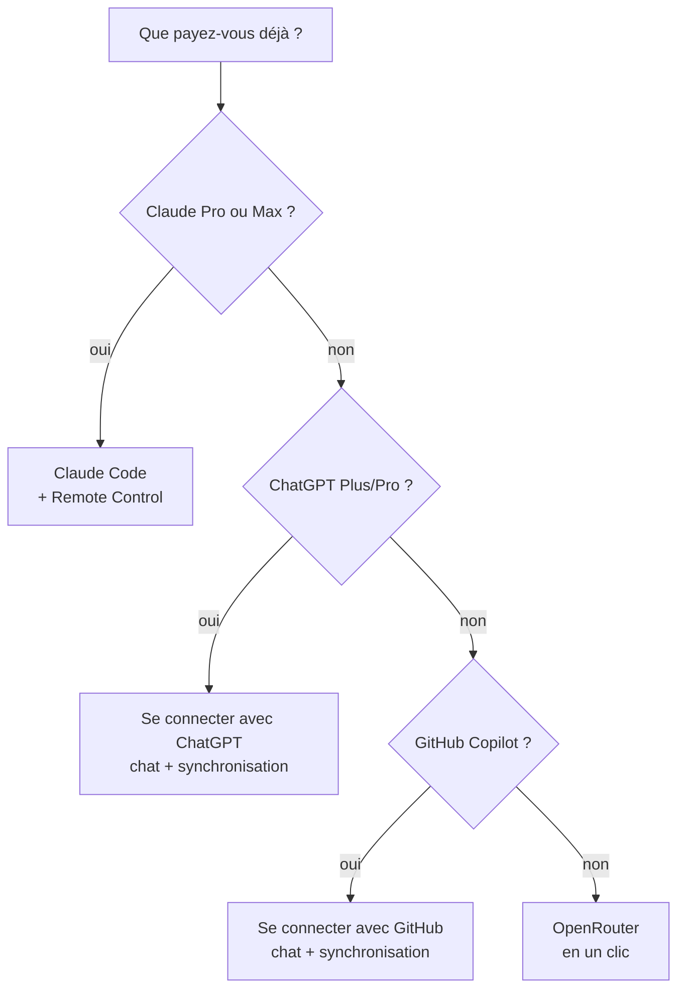

# Choisir son IA

Le coach a besoin d'un modèle de langage pour répondre, planifier et synchroniser vos données.
Bonne nouvelle : **vous n'avez pas à choisir une technologie, seulement à dire ce que vous avez déjà.**

## L'arbre de décision

| Vous avez… | Faites ceci | Coût en plus |
|---|---|---|
| **Claude Pro ou Max** | [Assistant habituel](#votre-assistant-habituel) : Claude Code, et [Remote Control](mobile.md) pour le téléphone | aucun |
| **ChatGPT Plus ou Pro** | [Se connecter avec ChatGPT](#chatgpt-plus-ou-pro) : `./install.sh --llm chatgpt --connect`, ou « J'ai ChatGPT Plus/Pro » dans l'application | aucun (limites de votre forfait) |
| **GitHub Copilot** | [Se connecter avec GitHub](#github-copilot) : `./install.sh --llm copilot --connect`, ou « J'ai GitHub Copilot » dans l'application | aucun (crédits de votre forfait) |
| **Rien** | [OpenRouter en un clic](#openrouter-en-un-clic) | environ 1 € par mois |
| Une clé API existante | [Coller sa clé](#cle-api-anthropic-openai-ou-autre) | selon le fournisseur |

## OpenRouter en un clic

OpenRouter donne accès à des dizaines de modèles avec un seul compte, facturé à l'usage. Le coach
s'y connecte comme une application « Se connecter avec… » : **aucune clé à créer ni à copier**.

- **Application macOS** : au choix du chat, laissez « Connecter OpenRouter ». Pendant l'installation,
  une page OpenRouter s'ouvre ; connectez-vous (ou créez un compte), autorisez le coach, c'est fini.
- **Ligne de commande** : `./install.sh --llm openrouter --connect`, ou plus tard
  `python3 scripts/arc_llm.py connect openrouter`.
- **Machine sans navigateur (SSH)** : `python3 scripts/arc_llm.py connect openrouter --headless`.
  Ouvrez l'adresse affichée sur un autre appareil, autorisez, puis collez le code affiché.

Ce que fait la connexion (OAuth PKCE, [documentation OpenRouter](https://openrouter.ai/docs/guides/overview/auth/oauth)) :
le script écoute sur `127.0.0.1` le temps de l'autorisation, échange le code contre une clé, l'écrit
dans `~/.config/ai-running-coach/llm.env` (mode 600), puis la vérifie. La clé n'est jamais affichée
ni écrite dans la configuration. Aucune inscription d'application et aucun secret du projet ne sont
nécessaires.

### Combien ça coûte

Mesuré sur un mois type (60 questions, 12 `/log`, 4 `/week`, 4 plans de semaine et 60
synchronisations automatiques) avec le modèle par défaut, DeepSeek v4.1 Flash : **≈ 0,80 €**
([détail et méthode](dashboard/chat.md#ce-que-coute-le-coach)). Concrètement :

> **10 $ une fois ≈ un an de coaching.**

Acheter 10 $ de crédit une seule fois débloque aussi le quota gratuit élevé d'OpenRouter
(voir [le tableau des offres gratuites](#et-le-gratuit)). Fixez le plafond quotidien du chat
(`--chat-budget`) ; quand le crédit est épuisé, le chat l'indique (« Crédit du fournisseur insuffisant (402) »).

### Vos données de santé

Le coach envoie au modèle votre HRV, votre sommeil, vos blessures. Chez OpenRouter, le fournisseur
du modèle compte : chacun a sa propre politique de conservation et d'entraînement
([politique de journalisation](https://openrouter.ai/docs/guides/privacy/logging)). Dans
[vos réglages de confidentialité](https://openrouter.ai/settings/privacy), refusez le routage vers
les fournisseurs qui peuvent entraîner sur vos données (réglage distinct pour les modèles payants et
gratuits ; OpenRouter précise que des exceptions existent). La **conservation**, elle, ne filtre pas
le routage : consultez le tableau des fournisseurs du modèle choisi.

## ChatGPT Plus ou Pro

OpenAI autorise l'usage du forfait ChatGPT dans les applications **open source et hébergées localement**
([« ChatGPT plan usage »](https://developers.openai.com/siwc/token-sharing-open-source)), et
[OpenCode](https://opencode.ai/docs/providers/), le moteur qui fait tourner le chat et la synchronisation,
sait s'y connecter. Rien n'est facturé au jeton : ce sont **les limites de votre forfait** qui s'appliquent.

- **Application macOS** : au choix du chat, « J'ai ChatGPT Plus/Pro ». À la fin de l'installation,
  une fenêtre Terminal affiche une adresse et un code d'appareil ; validez-les dans votre navigateur.
- **Ligne de commande** : `./install.sh --llm chatgpt --connect`, ou plus tard
  `python3 scripts/arc_llm.py login chatgpt`. La connexion par code d'appareil marche aussi par SSH ;
  `--browser` utilise à la place le navigateur de la machine (port local 1455).

**Forfaits.** Plus et Pro. La page d'OpenAI ne liste pas les forfaits éligibles ; dans le code d'OpenCode, un
compte **Free** reçoit l'erreur `usage_not_included` (« passez à Plus ») : il est refusé, et le coach
vous le dit. Le cas des autres offres (Go, Business…) n'a pas été vérifié.

**Modèles par défaut** : `openai/gpt-5.4-mini` pour le chat, `openai/gpt-5.4` pour la synchronisation. Leurs
identifiants sont vérifiés dans le catalogue [models.dev](https://models.dev) et dans la liste d'autorisation
du plugin ChatGPT d'OpenCode 1.18.35 ; ils **n'ont pas été évalués sur un vrai forfait** (comparatif du
projet : [dashboard/chat.md](dashboard/chat.md#quel-modele-sur-openrouter)) : changez-les avec
`--model` si votre forfait ne les sert pas.

**Synchronisation automatique.** Elle consomme les limites de votre forfait, comme le chat. Aucune
déclaration officielle sur l'usage planifié sans surveillance d'un forfait grand public n'a été trouvée
dans les pages consultées : relisez les conditions d'OpenAI avant de laisser la synchronisation tourner
chaque jour (vous pouvez la garder sur Claude Code ou OpenRouter et réserver ChatGPT au chat).

## GitHub Copilot

GitHub soutient officiellement OpenCode pour Copilot Pro, Pro+, Business et Enterprise, sans licence d'IA
supplémentaire ([annonce](https://github.blog/changelog/2026-01-16-github-copilot-now-supports-opencode/)).
Copilot **Free** n'est pas listé : il n'est pas pris en charge.

- **Application macOS** : « J'ai GitHub Copilot ». À la fin de l'installation, une fenêtre Terminal
  affiche un code à saisir sur `github.com/login/device`.
- **Ligne de commande** : `./install.sh --llm copilot --connect`, ou `python3 scripts/arc_llm.py login copilot`
  (dans un terminal : GitHub.com ou GitHub Enterprise vous est demandé).

Le forfait Copilot compte en « crédits » ([plans](https://docs.github.com/en/copilot/get-started/plans)) ; les
modèles les plus coûteux peuvent demander Pro+. Modèles par défaut : `github-copilot/gpt-5.4-mini` (chat) et
`github-copilot/claude-sonnet-5.5` (synchronisation), vérifiés dans models.dev et **non évalués sur un vrai
forfait** ; la liste réelle dépend de votre forfait. Même remarque que pour ChatGPT sur la synchronisation
automatique : elle consomme vos crédits, et aucune déclaration officielle sur l'usage planifié n'a été trouvée.

### Où est gardée la connexion, et ce qui est facturé

- **Magasin dédié au coach** : `~/.local/share/ai-running-coach/opencode` (mode 700, hors dépôt et hors de
  votre dossier de données), posé dans `[chat].opencode_data_dir` et `[sync].opencode_data_dir`
  ([configuration](configuration.md#chat-et-sync-sur-un-abonnement-chatgpt-ou-copilot)). OpenCode y écrit
  `auth.json` ; le coach ne lit jamais les jetons, il vérifie seulement leur présence. Votre éventuelle
  installation personnelle d'OpenCode n'est pas touchée.
- **Chat et synchronisation ne se marchent pas dessus** : OpenCode réécrit `auth.json` sans verrou quand il
  rafraîchit le jeton ChatGPT, et deux rafraîchissements simultanés pourraient casser la connexion. Le chat
  (un tour à la fois) et la synchronisation (une exécution) prennent donc le même verrou. Si le chat occupe le
  magasin plus de 5 minutes, la synchronisation est reportée au passage suivant (avec une notification) ; si
  la synchronisation l'occupe, le chat vous le dit et vous invite à réessayer.
- **Pas d'euros** : le compteur du chat affiche « inclus dans votre forfait ChatGPT » (ou Copilot) ; le plafond
  quotidien en euros ne compte rien (OpenCode rapporte un coût nul pour ChatGPT, et des dollars fictifs tirés
  des crédits pour Copilot, qui ne sont pas une facture). Seules les limites de votre forfait comptent.
- **Jamais de connexion automatique** : la synchronisation ne lance aucune connexion et n'ouvre aucun navigateur.
  Jeton absent ou expiré : notification « reconnectez ChatGPT : `python3 scripts/arc_llm.py login chatgpt` ».
- **Confidentialité** : vos échanges passent par votre compte OpenAI ou GitHub ; leurs réglages s'appliquent.

## Votre assistant habituel

Si vous payez déjà un assistant, utilisez-le : le coach n'ajoute aucune seconde facturation.

- **Claude Pro / Max** : Claude Code, et [Remote Control](mobile.md) pour le téléphone. L'abonnement
  Claude ne peut pas servir dans le chat intégré de l'application (Anthropic l'interdit dans un
  outil tiers) ; c'est donc Claude Code lui-même qui parle au coach.
- **GitHub Copilot** (assistant dans le terminal) : « Mon assistant IA habituel » de l'application, ou
  `./install.sh --ide copilot --sync-runner copilot`. Pour le chat intégré, préférez
  [Se connecter avec GitHub](#github-copilot).
- **ChatGPT Plus / Pro** (Codex CLI) : `./install.sh --sync-runner codex` pour la synchronisation. Pour le
  chat intégré, préférez [Se connecter avec ChatGPT](#chatgpt-plus-ou-pro).
- **Gemini CLI** : voir [l'avertissement ci-dessous](#gemini-attention).

## Clé API (Anthropic, OpenAI ou autre)

Pour qui a déjà une clé : `./install.sh --llm anthropic`, `--llm openai --model …` ou
`--llm openrouter` puis éditez `llm.env` (mode 600). Dans l'application macOS, c'est
« J'ai déjà une clé ». Détails : [Le chat avec le coach](dashboard/chat.md#installer).

## Gemini : attention

La page officielle des quotas ([geminicli.com](https://geminicli.com/docs/resources/quota-and-pricing/))
indique : « Unpaid tier and Google One users: Gemini CLI was replaced by Antigravity CLI on June
18th, 2026. » Un simple compte Google ne suffit donc plus pour Gemini CLI. Il reste utilisable :

- avec une **clé API Gemini** : 250 requêtes par jour, modèles Flash seulement (même page) ;
  sur ce palier gratuit, Google peut utiliser vos données et des relecteurs humains peuvent les lire
  ([conditions de l'API Gemini](https://ai.google.dev/gemini-api/terms)) : **à éviter pour des
  données de santé** ;
- avec une **licence payante**.

## Et le gratuit ?

Il existe, avec des pièges à connaître. Un tour de chat consomme **plusieurs requêtes** (une par appel
d'outil) : 50 requêtes par jour ne laissent que quelques questions.

| Option | Limites | Confidentialité | Source (consultée en octobre 2026) |
|---|---|---|---|
| OpenRouter, modèles `:free` | 20 requêtes/min ; **50/jour** ; **1 000/jour** après 9 à 10 $ de crédits achetés au total | la politique varie selon le fournisseur ; l'entraînement se refuse dans les réglages, avec des exceptions possibles | [limites](https://openrouter.ai/docs/api-reference/limits), [journalisation](https://openrouter.ai/docs/guides/privacy/logging) |
| Gemini, clé API gratuite | 250 requêtes/jour, Flash seulement | données utilisées par Google, relecteurs humains possibles | [quotas](https://geminicli.com/docs/resources/quota-and-pricing/), [conditions](https://ai.google.dev/gemini-api/terms) |

Pour des données de santé, le message honnête reste : **10 $ une fois, plutôt qu'un gratuit qui
garde vos prompts.**

## Ce qui n'est pas proposé, et pourquoi

Recherche de l'épique [#264](https://github.com/mmornati/ai-running-coach/issues/264) ; points non
revérifiés ici, à prendre comme l'état de cette recherche :

- **Abonnement Claude Pro/Max dans le chat intégré** : interdit par Anthropic dans un outil tiers.
- **Gemini CLI avec un compte Google gratuit** : remplacé par Antigravity CLI (voir plus haut).
- **Groq, Cerebras (paliers gratuits)** : un tour d'agent (agents, skills, outils) dépasse largement
  les 8 000 jetons par minute de Groq.
- **GitHub Models** : retiré le 30 juillet 2026.
- **OpenCode Zen, modèles gratuits** : liste tournante, gratuité temporaire.
- **Ollama en local** : privé et gratuit, mais les petits modèles appellent mal les outils ; réservé
  aux utilisateurs avancés.
- **Une clé « partagée » du projet** : coût et responsabilité sur vos données de santé.
