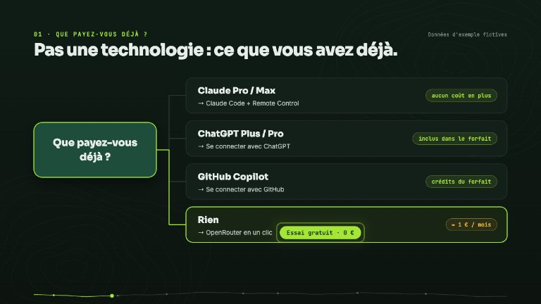
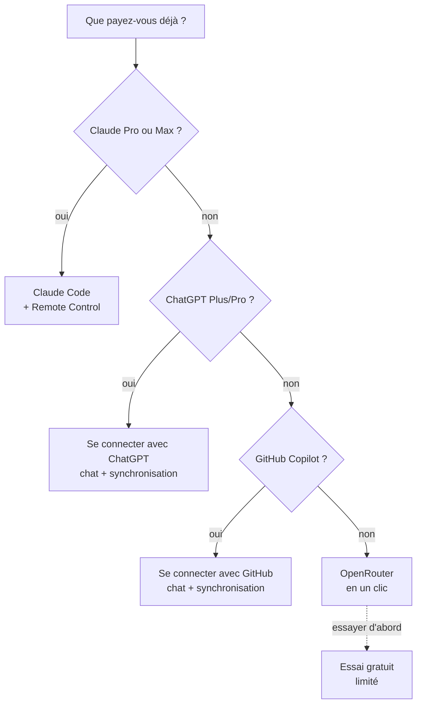

# Choisir son IA

Le coach a besoin d'un modèle de langage pour répondre, planifier et synchroniser vos données.
Bonne nouvelle : **vous n'avez pas à choisir une technologie, seulement à dire ce que vous avez déjà.**

<!-- arc-video:essai-gratuit -->
<div class="arc-video-card" markdown>

[](video/essai-gratuit/index.html)

<div markdown>

<span class="arc-video__meta">En vidéo · Étape 21 · 1 min 49</span>

**[Zéro euro pour démarrer](video/essai-gratuit/index.html)** — Quelle IA pour le coach ? Celle que vous payez déjà, sinon l'essai gratuit OpenRouter : une option à l'installation, une connexion en un clic sans clé à copier, puis ses limites dites honnêtement (quota, confidentialité) et le passage à « 10 $ une fois ».

[Regarder](video/essai-gratuit/index.html) · [English](video/essai-gratuit/index.html?lang=en) · [Toutes les vidéos](videos.md)

</div>

</div>
<!-- /arc-video -->

## L'arbre de décision



| Vous avez… | Faites ceci | Coût en plus |
|---|---|---|
| **Claude Pro ou Max** | [Assistant habituel](#votre-assistant-habituel) : Claude Code, et [Remote Control](mobile.md) pour le téléphone | aucun |
| **ChatGPT Plus ou Pro** | [Se connecter avec ChatGPT](#chatgpt-plus-ou-pro) : `./install.sh --llm chatgpt --connect`, ou « J'ai ChatGPT Plus/Pro » dans l'application | aucun (limites de votre forfait) |
| **GitHub Copilot** | [Se connecter avec GitHub](#github-copilot) : `./install.sh --llm copilot --connect`, ou « J'ai GitHub Copilot » dans l'application | aucun (crédits de votre forfait) |
| **Rien** | [OpenRouter en un clic](#openrouter-en-un-clic) | environ 1 € par mois |
| **Rien, et je veux essayer d'abord** | [Essai gratuit](#essai-gratuit) : `./install.sh --llm openrouter-free --connect`, ou « Essai gratuit (limité) » dans l'application | 0 € (environ un `/log` et quelques questions par jour ; prompts conservés) |
| Une clé API existante | [Coller sa clé](#cle-api-anthropic-openai-ou-autre) | selon le fournisseur |

## OpenRouter en un clic

OpenRouter donne accès à des dizaines de modèles avec un seul compte, facturé à l'usage. Le coach
s'y connecte comme une application « Se connecter avec… » : **aucune clé à créer ni à copier**.

- **Application macOS** : au choix du chat, laissez « Connecter OpenRouter ». Pendant l'installation,
  une page OpenRouter s'ouvre ; connectez-vous (ou créez un compte), autorisez le coach, c'est fini.
- **Ligne de commande** : `./install.sh --llm openrouter --connect`, ou plus tard
  `python3 scripts/arc_llm.py connect openrouter`.
- **Machine sans navigateur (SSH)** : `python3 scripts/arc_llm.py connect openrouter --headless`.
  Ouvrez l'adresse affichée sur un autre appareil, autorisez, puis collez le code affiché.

Ce que fait la connexion (OAuth PKCE, [documentation OpenRouter](https://openrouter.ai/docs/guides/overview/auth/oauth)) :
le script écoute sur `127.0.0.1` le temps de l'autorisation, échange le code contre une clé, l'écrit
dans `~/.config/ai-running-coach/llm.env` (mode 600), puis la vérifie. La clé n'est jamais affichée
ni écrite dans la configuration. Aucune inscription d'application et aucun secret du projet ne sont
nécessaires.

!!! tip "Plafonner la clé dès l'autorisation"
    La page d'autorisation d'OpenRouter propose une **limite de crédit** (remise à zéro périodique
    possible) et une **date d'expiration** pour la clé créée. Une limite de quelques euros protège
    contre une conversation qui s'emballe, en plus du plafond quotidien du coach. Les clés se
    révoquent à tout moment dans [vos clés OpenRouter](https://openrouter.ai/settings/keys).

### Combien ça coûte

Mesuré sur un mois type (60 questions, 12 `/log`, 4 `/week`, 4 plans de semaine et 60
synchronisations automatiques) avec le modèle par défaut, DeepSeek v4.1 Flash : **≈ 0,80 €**
([détail et méthode](dashboard/chat.md#ce-que-coute-le-coach)). Concrètement :

> **10 $ une fois ≈ un an de coaching.**

Acheter 10 $ de crédit une seule fois débloque aussi le quota gratuit élevé d'OpenRouter
(voir [le tableau des offres gratuites](#et-le-gratuit)). Fixez le plafond quotidien du chat
(`--chat-budget`) ; quand le crédit est épuisé, le chat l'indique (« Crédit du fournisseur insuffisant (402) »).

### Vos données de santé

Le coach envoie au modèle votre HRV, votre sommeil, vos blessures. Chez OpenRouter, le fournisseur
du modèle compte : chacun a sa propre politique de conservation et d'entraînement
([politique de journalisation](https://openrouter.ai/docs/guides/privacy/logging)). Dans
[vos réglages de confidentialité](https://openrouter.ai/settings/privacy), refusez le routage vers
les fournisseurs qui peuvent entraîner sur vos données (réglage distinct pour les modèles payants et
gratuits ; OpenRouter précise que des exceptions existent). La **conservation**, elle, ne filtre pas
le routage : consultez le tableau des fournisseurs du modèle choisi.

## ChatGPT Plus ou Pro

OpenAI autorise l'usage du forfait ChatGPT dans les applications **open source et hébergées localement**
([« ChatGPT plan usage »](https://developers.openai.com/siwc/token-sharing-open-source)), et
[OpenCode](https://opencode.ai/docs/providers/), le moteur qui fait tourner le chat et la synchronisation,
sait s'y connecter. Rien n'est facturé au jeton : ce sont **les limites de votre forfait** qui s'appliquent.

- **Application macOS** : au choix du chat, « J'ai ChatGPT Plus/Pro ». À la fin de l'installation,
  une fenêtre Terminal affiche une adresse et un code d'appareil ; validez-les dans votre navigateur.
- **Ligne de commande** : `./install.sh --llm chatgpt --connect`, ou plus tard
  `python3 scripts/arc_llm.py login chatgpt`. La connexion par code d'appareil marche aussi par SSH ;
  `--browser` utilise à la place le navigateur de la machine (port local 1455).

**Forfaits.** Plus et Pro. La page d'OpenAI ne liste pas les forfaits éligibles ; dans le code d'OpenCode, un
compte **Free** reçoit l'erreur `usage_not_included` (« passez à Plus ») : il est refusé, et le coach
vous le dit. Le cas des autres offres (Go, Business…) n'a pas été vérifié.

**Modèles par défaut** : `openai/gpt-5.4-mini` pour le chat, `openai/gpt-5.4` pour la synchronisation. Leurs
identifiants sont vérifiés dans le catalogue [models.dev](https://models.dev) et dans la liste d'autorisation
du plugin ChatGPT d'OpenCode 1.18.35 ; ils **n'ont pas été évalués sur un vrai forfait** (comparatif du
projet : [dashboard/chat.md](dashboard/chat.md#quel-modele-sur-openrouter)) : changez-les avec
`--model` si votre forfait ne les sert pas.

**Synchronisation automatique : un choix explicite.** `--llm chatgpt` règle le **chat**. La synchronisation
ne passe sur l'abonnement que sur une installation **neuve** (aucune installation antérieure : options mémorisées,
planificateur de la synchronisation, `[sync].runner`) ou si vous ajoutez `--sync-subscription`
(`--no-sync-subscription` l'interdit, même sur une installation neuve) ; sinon elle garde son exécuteur actuel et l'installation vous dit comment basculer.
Pourquoi : aucune déclaration officielle sur l'usage planifié, sans surveillance, d'un forfait grand public
n'a été trouvée dans les pages consultées, et chaque passage consomme vos limites. Relisez les conditions
d'OpenAI avant de l'activer. Dans l'application macOS, la case « Synchroniser aussi avec mon forfait » est
cochée par défaut (l'application n'a pas d'autre exécuteur de synchronisation dans ce mode) ; décochée, la
synchronisation automatique n'est pas installée.

## GitHub Copilot

GitHub soutient officiellement OpenCode pour Copilot Pro, Pro+, Business et Enterprise, sans licence d'IA
supplémentaire ([annonce](https://github.blog/changelog/2026-01-16-github-copilot-now-supports-opencode/)).
Copilot **Free** n'est pas listé : il n'est pas pris en charge.

- **Application macOS** : « J'ai GitHub Copilot ». À la fin de l'installation, une fenêtre Terminal
  affiche un code à saisir sur `github.com/login/device`.
- **Ligne de commande** : `./install.sh --llm copilot --connect`, ou `python3 scripts/arc_llm.py login copilot`
  (dans un terminal : GitHub.com ou GitHub Enterprise vous est demandé).

Le forfait Copilot compte en « crédits » ([plans](https://docs.github.com/en/copilot/get-started/plans)) ; les
modèles les plus coûteux peuvent demander Pro+. Modèles par défaut : `github-copilot/gpt-5.4-mini` (chat) et
`github-copilot/claude-sonnet-5.5` (synchronisation), vérifiés dans models.dev et **non évalués sur un vrai
forfait** ; la liste réelle dépend de votre forfait. Même remarque que pour ChatGPT sur la synchronisation
automatique : elle consomme vos crédits, et aucune déclaration officielle sur l'usage planifié n'a été trouvée.

### Où est gardée la connexion, et ce qui est facturé

- **Magasin dédié au coach** : `~/.local/share/ai-running-coach/opencode` (mode 700, hors dépôt et hors de
  votre dossier de données), posé dans `[chat].opencode_data_dir` et `[sync].opencode_data_dir`
  ([configuration](configuration.md#chat-et-sync-sur-un-abonnement-chatgpt-ou-copilot)). OpenCode y écrit
  `auth.json` ; le coach ne lit jamais les jetons, il vérifie seulement leur présence. Votre éventuelle
  installation personnelle d'OpenCode n'est pas touchée.
- **Chat et synchronisation ne se marchent pas dessus** : OpenCode réécrit `auth.json` sans verrou quand il
  rafraîchit le jeton ChatGPT, et deux rafraîchissements simultanés pourraient casser la connexion. Le chat
  (tous ses tours partagent un seul verrou, pris au premier et rendu au dernier) et la synchronisation (une
  exécution) prennent donc le même verrou. Le chat le tient **pendant tout le tour, attentes d'approbation
  comprises**, et le rend à la fin du tour, quoi qu'il arrive. Si le chat l'occupe plus de 5 minutes, la
  synchronisation est simplement reportée au passage suivant (une notification par jour au plus, sans échec) ;
  si la synchronisation l'occupe, le chat affiche « Synchronisation en cours… », attend jusqu'à 2 minutes, puis
  vous invite à réessayer.
- **Une base de sessions par usage** : `auth.json` est partagé (`XDG_DATA_HOME`), mais le chat et la
  synchronisation ont chacun leur base de sessions (`OPENCODE_DB`), et les instantanés de fichiers d'OpenCode
  sont désactivés (`"snapshot": false`) dans leurs configurations.
- **Seule une connexion de type abonnement compte** : une clé API rangée dans ce magasin n'est jamais prise
  pour un abonnement.
- **Pas d'euros** : le compteur du chat affiche « inclus dans votre forfait ChatGPT » (ou Copilot) ; le plafond
  quotidien en euros ne compte rien (OpenCode rapporte un coût nul pour ChatGPT, et des dollars fictifs tirés
  des crédits pour Copilot, qui ne sont pas une facture). Seules les limites de votre forfait comptent.
- **Jamais de connexion automatique** : la synchronisation ne lance aucune connexion et n'ouvre aucun navigateur.
  Jeton absent ou expiré : notification « reconnectez ChatGPT : `python3 scripts/arc_llm.py login chatgpt` ».
- **Confidentialité** : vos échanges passent par votre compte OpenAI ou GitHub ; leurs réglages s'appliquent.

## Votre assistant habituel

Si vous payez déjà un assistant, utilisez-le : le coach n'ajoute aucune seconde facturation.

- **Claude Pro / Max** : Claude Code, et [Remote Control](mobile.md) pour le téléphone. L'abonnement
  Claude ne peut pas servir dans le chat intégré de l'application (Anthropic l'interdit dans un
  outil tiers) ; c'est donc Claude Code lui-même qui parle au coach.
- **GitHub Copilot** (assistant dans le terminal) : « Mon assistant IA habituel » de l'application, ou
  `./install.sh --ide copilot --sync-runner copilot`. Pour le chat intégré, préférez
  [Se connecter avec GitHub](#github-copilot).
- **ChatGPT Plus / Pro** (Codex CLI) : `./install.sh --sync-runner codex` pour la synchronisation. Pour le
  chat intégré, préférez [Se connecter avec ChatGPT](#chatgpt-plus-ou-pro).
- **Gemini CLI** : voir [l'avertissement ci-dessous](#gemini-attention).

## Clé API (Anthropic, OpenAI ou autre)

Pour qui a déjà une clé : `./install.sh --llm anthropic`, `--llm openai --model …` ou
`--llm openrouter` puis éditez `llm.env` (mode 600). Dans l'application macOS, c'est
« J'ai déjà une clé ». Détails : [Le chat avec le coach](dashboard/chat.md#installer).

## Changer l'IA de la synchronisation

`./install.sh --llm …` règle le chat **et** la synchronisation. Pour ne changer **que** la
synchronisation automatique (le chat reste tel quel), une commande suffit :

```bash
python3 scripts/arc_llm.py sync                      # sur quoi tourne la sync aujourd'hui
python3 scripts/arc_llm.py sync anthropic            # Claude Code avec la clé API Anthropic
```

Cas typique : la sync tourne sur votre abonnement Claude et s'arrête quand le forfait atteint sa limite
(« You've hit your weekly limit » dans `logs/sync-AAAA-MM-JJ.log`, notification « ⏳ limite de
l'abonnement Claude atteinte »). Avec `sync anthropic`, elle garde le même exécuteur (`claude -p`, mêmes
permissions, mêmes scripts : météo, ligne de dépense…) mais paie au jeton avec la clé de `llm.env`.

| Commande | La synchronisation tourne sur | Clé (dans `llm.env`) |
|---|---|---|
| `sync anthropic [--model claude-…]` | `claude -p` + API Anthropic, modèle par défaut `claude-haiku-4-5` | `ANTHROPIC_API_KEY` |
| `sync openrouter [--model …]` | `opencode` + OpenRouter | `OPENROUTER_API_KEY` |
| `sync openrouter-free` | `opencode` + modèle gratuit `:free` ([limites](#essai-gratuit)) | `OPENROUTER_API_KEY` |
| `sync openai --model … [--base-url URL]` | `opencode` + API compatible OpenAI | `OPENAI_API_KEY` |
| `sync claude-subscription` | `claude -p` sur votre abonnement Claude (retour en arrière) | aucune |

Ce que fait la commande :

- elle n'écrit que `runner`, `model`, `base_url`, `api_key_env` (et vide `opencode_data_dir` s'il était
  posé) dans la section `[sync]` de `config/workspace.user.toml`, et affiche chaque changement
  « ancien → nouveau » avec la commande pour revenir. `mode`, `times`, le budget et le chat ne bougent pas ;
- **aucune réinstallation** : `daily-sync.sh` relit `[sync]` à chaque passage (cron, launchd ou `watch`) ;
  vérifiez avec `scripts/daily-sync.sh --dry-run` ;
- elle **refuse** (rien n'est écrit) si la clé visée n'est pas dans `llm.env` : ajoutez d'abord la ligne
  `ANTHROPIC_API_KEY=…` (mode 600), ou `python3 scripts/arc_llm.py connect openrouter` pour OpenRouter ;
- elle signale le changement de facturation : abonnement → clé facturée au jeton, plafonnée par
  `[sync].daily_budget_eur` (0,50 € par jour par défaut, `./install.sh --sync-budget EUR`).

`--dry-run` montre les changements sans rien écrire ; `--json` rend un objet (jamais la valeur d'une clé).
Le chat se règle à part (`[chat]`, [Le chat avec le coach](dashboard/chat.md)) : chat et synchronisation
peuvent utiliser deux IA différentes. Les abonnements ChatGPT et Copilot gardent leur propre chemin
(`./install.sh --llm chatgpt|copilot --sync-subscription`, voir [plus haut](#chatgpt-plus-ou-pro)).

!!! warning "La clé Anthropic reste dans `llm.env`"
    N'exportez pas `ANTHROPIC_API_KEY` dans votre shell : elle casse Remote Control. La sync la lit dans
    `llm.env` et ne la donne qu'au process `claude -p` de chaque passage ; dans ce process, la clé passe
    avant la connexion claude.ai (vérifié le 2026-10-18 avec Claude Code 2.1.283, qui l'annonce sur sa sortie
    d'erreur).

## Gemini : attention

La page officielle des quotas ([geminicli.com](https://geminicli.com/docs/resources/quota-and-pricing/))
indique : « Unpaid tier and Google One users: Gemini CLI was replaced by Antigravity CLI on June
18th, 2026. » Un simple compte Google ne suffit donc plus pour Gemini CLI. Il reste utilisable :

- avec une **clé API Gemini** : 250 requêtes par jour, modèles Flash seulement (même page) ;
  sur ce palier gratuit, Google peut utiliser vos données et des relecteurs humains peuvent les lire
  ([conditions de l'API Gemini](https://ai.google.dev/gemini-api/terms)) : **à éviter pour des
  données de santé** ;
- avec une **licence payante**.

## Essai gratuit

Pour **essayer avant de payer quoi que ce soit** : OpenRouter propose des modèles dits `:free`. Le coach
sait s'y brancher (`./install.sh --llm openrouter-free --connect`, ou « Essai gratuit (limité) » dans
l'application macOS), avec la **même connexion en un clic** qu'[OpenRouter](#openrouter-en-un-clic).
Coût : **0 €**, donc aucun plafond en euros. En échange, deux limites à connaître avant de choisir.

### Ce que l'essai permet vraiment

| Limite | Valeur | Source (consultée le 15 octobre 2026) |
|---|---|---|
| Requêtes par minute | 20 | [limites OpenRouter](https://openrouter.ai/docs/api-reference/limits) |
| Requêtes par jour, **sans achat de crédits** | **50** | idem |
| Requêtes par jour après **10 $ de crédits achetés au total** | 1 000 | idem (le palier haut démarre dès 9 $ achetés) |

Un tour de chat consomme **plusieurs requêtes** (une par appel d'outil). Mesuré avec le modèle par défaut
et les autres modèles gratuits essayés (workspace synthétique, 15 octobre 2026) :

| Demande | Requêtes LLM consommées |
|---|---|
| `/log` (une phrase : gels, eau, douleur, RPE) | **17 à 48** |
| `/week` | 6 à 12 |
| Bilan matinal (« je me sens fatigué, je garde la séance ? ») | 4 à 9 |

Honnêtement : **sans achat, comptez environ un `/log` et quelques questions par jour.** Une fois les 50
requêtes épuisées, le chat répond « Quota gratuit du jour atteint (50 requêtes sans achat, 1 000 après 10 $ de
crédits) : réessayez demain (le compteur suit le jour UTC) ou ajoutez des crédits sur openrouter.ai. » Pour
ménager ce quota, l'installation propose la synchronisation en
[mode `watch`](mobile.md#mode-watch-ne-payer-le-llm-que-quand-garmin-a-du-neuf) (le modèle ne travaille que
s'il y a du neuf) — **uniquement si vous n'avez pas déjà choisi un `[sync].mode`**, qui n'est jamais écrasé
(et seulement avec Garmin). Pour connaître le reste du jour : `python3 scripts/arc_llm.py free-quota`
(lit `free_model_daily_requests` dans `GET /api/v1/key`, un appel léger, sans effet connu sur le quota).

### Vos données de santé : le point faible de l'essai

!!! warning "Les modèles gratuits peuvent retenir vos prompts"
    Selon les pages de modèles d'OpenRouter (à vérifier : la politique est celle du fournisseur et peut
    changer), les fournisseurs des modèles essayés **conservent les prompts** ; les modèles NVIDIA (dont le
    modèle par défaut) déclarent **s'entraîner dessus**. (Les modèles NVIDIA et cohere ont pourtant passé le
    filtre ZDR du compte utilisé pour nos essais : la page du fournisseur et l'exigence ZDR ne se recoupent pas, ne déduisez
    pas une absence de rétention.) Le coach
    envoie votre HRV, votre sommeil, vos blessures. **N'utilisez pas l'essai gratuit pour des données de
    santé sensibles.** Réglages : [confidentialité OpenRouter](https://openrouter.ai/settings/privacy).
    Mieux : OpenRouter payant avec DeepSeek (≈ 0,80 € par mois) ou « 10 $ une fois ».

Lecture des pages de modèles du 15 octobre 2026 (le champ `data_policy` n'est pas dans l'API `/models`,
et peut changer) :

| Modèle gratuit | Fournisseur | Entraînement | Conserve les prompts |
|---|---|---|---|
| `nvidia/nemotron-3-ultra-550b-a55b:free` (défaut) | NVIDIA (API d'essai) | **oui** | oui |
| `nvidia/nemotron-3-super-120b-a12b:free` | NVIDIA (API d'essai) | oui | oui |
| `google/gemma-4-31b-it:free` | Google AI Studio | non | oui, 55 jours |
| `cohere/north-mini-code:free`, `nvidia/nemotron-3.5-lightning:free` | non relevé page par page | à revérifier | à revérifier |

Seul Gemma 4 déclare ne pas s'entraîner, mais il **n'a pas pu être essayé** (sur le compte utilisé pour nos essais, avec
ZDR imposé, il répond 404) : il n'est donc pas le modèle par défaut. **Si vous refusez, dans vos réglages
OpenRouter, les fournisseurs qui s'entraînent sur vos données, le modèle par défaut (NVIDIA) devient
inutilisable (404)** : choisissez alors un autre modèle gratuit (Gemma 4, non testé) ou un modèle payant.

### Quel modèle gratuit ?

Méthode (15 octobre 2026) : workspace synthétique de 60 jours (`tests/lib/synthetic.py`), `opencode run`
avec chaque modèle sur trois demandes — `/log` « 2 gels Aptonia + 500 ml, genou gauche 2/10, RPE 6 »,
« je me sens fatigué, je garde la séance ? » et `/week` — puis un score sur 19 (tour terminé, français
propre, fichiers valides **datés du jour**, valeurs exactes 46 g de glucides / 500 ml / RPE 6, garde-fous
appelés). Les identifiants ont été relevés dans `https://openrouter.ai/api/v1/models` (suffixe `:free`,
outils pris en charge, contexte d'au moins 64 000 jetons).

| Modèle | Score | Requêtes LLM (`/log` / bilan / `/week`) | Verdict |
|---|---|---|---|
| `nvidia/nemotron-3-ultra-550b-a55b:free` | **19/19** | 31 (17 / 4 / 10) | **défaut** : seul parfait ; lent sur `/log` (275 s) ; libellés `done/planned` en anglais dans le tableau de `/week` |
| `nvidia/nemotron-3.5-lightning:free` | 17/19 | 35 (18 / 5 / 12) | fichiers corrects, mais anglais mêlé dans les réponses finales |
| `cohere/north-mini-code:free` | 17/19 | 42 (27 / 9 / 6) | rapide, mais a écrit les fichiers du `/log` **à une mauvaise date** : à éviter comme défaut |
| `nvidia/nemotron-3-super-120b-a12b:free` | 13/19 | 57 (48 / 5 / 4) | trop lent : `/log` et `/week` n'ont pas fini en 6 minutes |
| `google/gemma-4-31b-it:free` | — | — | non testé (404 avec ZDR sur le compte utilisé pour nos essais) |

Pour changer : `./install.sh --llm openrouter-free --model cohere/north-mini-code:free` (l'identifiant doit
finir par `:free`).

**Limites de cette mesure** : un seul passage par modèle (des écarts de un ou deux points ne sont pas
significatifs) ; la latence des modèles gratuits varie beaucoup dans la journée et avec le parallélisme
(quatre modèles lancés ensemble) ; **pas de Garmin ni de serveur MCP** dans l'essai (le bilan lisait
`medical/`), donc la synchronisation headless n'a pas été essayée telle quelle ; aucune erreur 429 pendant
les essais (compte à 1 000 requêtes par jour), donc le comportement réel à 50 par jour n'a pas été mesuré ;
le catalogue gratuit change vite (aucun modèle `:free` Qwen, DeepSeek, GLM ou Gemini ce jour-là).

### Si ça ne marche pas

- **« Quota gratuit du jour atteint »** (429) : réessayez demain, ou achetez 10 $ de crédits une fois pour
  passer à 1 000 requêtes par jour.
- **« Limite par minute … »** ou **« fournisseur … saturé »** (429) : attendez une minute ; un 429 peut
  venir du fournisseur du modèle, pas de votre quota.
- **« Le fournisseur du modèle gratuit est saturé … »** (503, `provider_overloaded`) : le fournisseur du
  modèle (NVIDIA pour le modèle par défaut) est surchargé, ce n'est pas votre quota ; réessayez dans quelques
  minutes, ou changez de modèle si cela dure.
- **« … réglage de confidentialité … »** (404 « ZDR violation » ou « data policy ») : votre réglage
  OpenRouter (entraînement, rétention ou ZDR) exclut tous les fournisseurs du modèle. Cause la plus probable :
  vous avez refusé les fournisseurs qui s'entraînent (notre conseil pour la santé), ce qui exclut NVIDIA, le
  modèle par défaut. Constaté sur le compte utilisé pour nos essais : avec ZDR imposé, Gemma 4 répond 404 alors que les
  modèles NVIDIA et cohere passent. Choisissez un autre modèle gratuit (Gemma 4, non testé) ou un modèle
  payant, ou ajustez les [réglages de confidentialité](https://openrouter.ai/settings/privacy).

Notifications de la synchronisation : [Dépannage](troubleshooting.md#synchronisation-sur-une-api-openrouter-anthropic).

Un doute sur la clé, le crédit ou la connexion ? Le bouton **Tester la connexion** (App macOS ou page du chat) ou `python3 scripts/arc_llm.py check --probe` dit lequel de ces cas vous concerne et la commande qui le corrige : [Dépannage — La connexion IA](troubleshooting.md#la-connexion-ia).

## Et le gratuit ?

Il existe, avec des pièges à connaître. Un tour de chat consomme **plusieurs requêtes** (une par appel
d'outil) : 50 requêtes par jour ne laissent que quelques questions.

| Option | Limites | Confidentialité | Source (consultée en octobre 2026) |
|---|---|---|---|
| OpenRouter, modèles `:free` | 20 requêtes/min ; **50/jour** ; **1 000/jour** après 9 à 10 $ de crédits achetés au total | la politique varie selon le fournisseur ; l'entraînement se refuse dans les réglages, avec des exceptions possibles | [limites](https://openrouter.ai/docs/api-reference/limits), [journalisation](https://openrouter.ai/docs/guides/privacy/logging) |
| Gemini, clé API gratuite | 250 requêtes/jour, Flash seulement | données utilisées par Google, relecteurs humains possibles | [quotas](https://geminicli.com/docs/resources/quota-and-pricing/), [conditions](https://ai.google.dev/gemini-api/terms) |

Le détail de l'option OpenRouter (modèle par défaut, mesures, limites) est dans [Essai gratuit](#essai-gratuit).

Pour des données de santé, le message honnête reste : **10 $ une fois, plutôt qu'un gratuit qui
garde vos prompts.**

## Ce qui n'est pas proposé, et pourquoi

Recherche de l'épique [#264](https://github.com/mmornati/ai-running-coach/issues/264) ; points non
revérifiés ici, à prendre comme l'état de cette recherche :

- **Abonnement Claude Pro/Max dans le chat intégré** : interdit par Anthropic dans un outil tiers.
- **Gemini CLI avec un compte Google gratuit** : remplacé par Antigravity CLI (voir plus haut).
- **Groq, Cerebras (paliers gratuits)** : un tour d'agent (agents, skills, outils) dépasse largement
  les 8 000 jetons par minute de Groq.
- **GitHub Models** : retiré le 30 juillet 2026.
- **OpenCode Zen, modèles gratuits** : liste tournante, gratuité temporaire.
- **Ollama en local** : privé et gratuit, mais les petits modèles appellent mal les outils ; réservé
  aux utilisateurs avancés.
- **Une clé « partagée » du projet** : coût et responsabilité sur vos données de santé.
