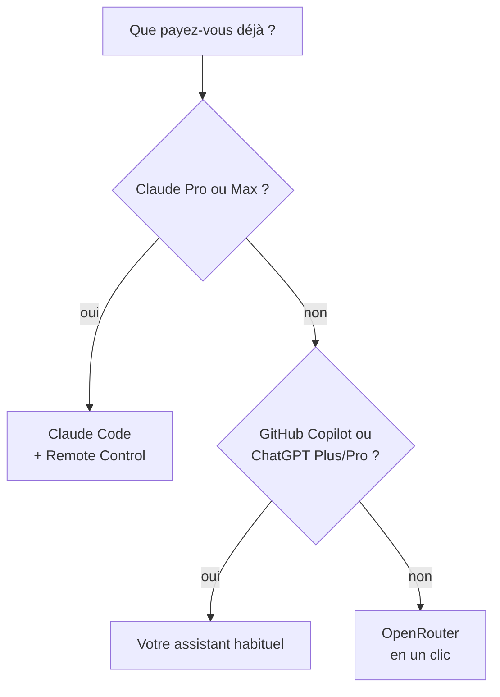

# Choisir son IA

Le coach a besoin d'un modèle de langage pour répondre, planifier et synchroniser vos données.
Bonne nouvelle : **vous n'avez pas à choisir une technologie, seulement à dire ce que vous avez déjà.**

## L'arbre de décision

| Vous avez… | Faites ceci | Coût en plus |
|---|---|---|
| **Claude Pro ou Max** | [Assistant habituel](#votre-assistant-habituel) : Claude Code, et [Remote Control](mobile.md) pour le téléphone | aucun |
| **GitHub Copilot** | [Assistant habituel](#votre-assistant-habituel) : GitHub Copilot (choix guidé dans l'application) | aucun |
| **ChatGPT Plus ou Pro** | [Assistant habituel](#votre-assistant-habituel) : Codex CLI, en ligne de commande (`--sync-runner codex`) ; pas encore dans l'application | aucun |
| **Rien** | [OpenRouter en un clic](#openrouter-en-un-clic) | environ 1 € par mois |
| Une clé API existante | [Coller sa clé](#cle-api-anthropic-openai-ou-autre) | selon le fournisseur |

## OpenRouter en un clic

OpenRouter donne accès à des dizaines de modèles avec un seul compte, facturé à l'usage. Le coach
s'y connecte comme une application « Se connecter avec… » : **aucune clé à créer ni à copier**.

- **Application macOS** : au choix du chat, laissez « Connecter OpenRouter ». Pendant l'installation,
  une page OpenRouter s'ouvre ; connectez-vous (ou créez un compte), autorisez le coach, c'est fini.
- **Ligne de commande** : `./install.sh --llm openrouter --connect`, ou plus tard
  `python3 scripts/arc_llm.py connect openrouter`.
- **Machine sans navigateur (SSH)** : `python3 scripts/arc_llm.py connect openrouter --headless`.
  Ouvrez l'adresse affichée sur un autre appareil, autorisez, puis collez le code affiché.

Ce que fait la connexion (OAuth PKCE, [documentation OpenRouter](https://openrouter.ai/docs/guides/overview/auth/oauth)) :
le script écoute sur `127.0.0.1` le temps de l'autorisation, échange le code contre une clé, l'écrit
dans `~/.config/ai-running-coach/llm.env` (mode 600), puis la vérifie. La clé n'est jamais affichée
ni écrite dans la configuration. Aucune inscription d'application et aucun secret du projet ne sont
nécessaires.

### Combien ça coûte

Mesuré sur un mois type (60 questions, 12 `/log`, 4 `/week`, 4 plans de semaine et 60
synchronisations automatiques) avec le modèle par défaut, DeepSeek v4.1 Flash : **≈ 0,80 €**
([détail et méthode](dashboard/chat.md#ce-que-coute-le-coach)). Concrètement :

> **10 $ une fois ≈ un an de coaching.**

Acheter 10 $ de crédit une seule fois débloque aussi le quota gratuit élevé d'OpenRouter
(voir [le tableau des offres gratuites](#et-le-gratuit)). Fixez le plafond quotidien du chat
(`--chat-budget`) ; le coach s'arrête proprement quand le crédit est épuisé.

### Vos données de santé

Le coach envoie au modèle votre HRV, votre sommeil, vos blessures. Chez OpenRouter, le fournisseur
du modèle compte : certains conservent les requêtes ou s'entraînent dessus
([politique de journalisation](https://openrouter.ai/docs/guides/privacy/logging)). Dans
[vos réglages de confidentialité](https://openrouter.ai/settings/privacy), n'autorisez que des
fournisseurs qui ne conservent ni n'entraînent sur vos données.

## Votre assistant habituel

Si vous payez déjà un assistant, utilisez-le : le coach n'ajoute aucune seconde facturation.

- **Claude Pro / Max** : Claude Code, et [Remote Control](mobile.md) pour le téléphone. L'abonnement
  Claude ne peut pas servir dans le chat intégré de l'application (Anthropic l'interdit dans un
  outil tiers) ; c'est donc Claude Code lui-même qui parle au coach.
- **GitHub Copilot** : choisissez-le dans « Mon assistant IA habituel » de l'application, ou
  `./install.sh --ide copilot --sync-runner copilot`.
- **ChatGPT Plus / Pro** : Codex CLI, l'assistant de ChatGPT, connecté à votre forfait
  (`./install.sh --sync-runner codex` pour la synchronisation). Il n'est pas encore proposé dans
  l'application macOS.
- **Gemini CLI** : voir [l'avertissement ci-dessous](#gemini-attention).

## Clé API (Anthropic, OpenAI ou autre)

Pour qui a déjà une clé : `./install.sh --llm anthropic`, `--llm openai --model …` ou
`--llm openrouter` puis éditez `llm.env` (mode 600). Dans l'application macOS, c'est
« J'ai déjà une clé ». Détails : [Le chat avec le coach](dashboard/chat.md#installer).

## Gemini : attention

La page officielle des quotas ([geminicli.com](https://geminicli.com/docs/resources/quota-and-pricing/))
indique : « Unpaid tier and Google One users: Gemini CLI was replaced by Antigravity CLI on June
18th, 2026. » Un simple compte Google ne suffit donc plus pour Gemini CLI. Il reste utilisable :

- avec une **clé API Gemini** : 250 requêtes par jour, modèles Flash seulement (même page) ;
  sur ce palier gratuit, Google peut utiliser vos données et des relecteurs humains peuvent les lire
  ([conditions de l'API Gemini](https://ai.google.dev/gemini-api/terms)) : **à éviter pour des
  données de santé** ;
- avec une **licence payante**.

## Et le gratuit ?

Il existe, avec des pièges à connaître. Un tour de chat consomme **plusieurs requêtes** (une par appel
d'outil) : 50 requêtes par jour ne laissent que quelques questions.

| Option | Limites | Confidentialité | Source (consultée en octobre 2026) |
|---|---|---|---|
| OpenRouter, modèles `:free` | 20 requêtes/min ; **50/jour** ; **1 000/jour** après 9 à 10 $ de crédits achetés au total | plusieurs hôtes gratuits conservent ou entraînent sur les prompts | [limites](https://openrouter.ai/docs/api-reference/limits), [journalisation](https://openrouter.ai/docs/guides/privacy/logging) |
| Gemini, clé API gratuite | 250 requêtes/jour, Flash seulement | données utilisées par Google, relecteurs humains possibles | [quotas](https://geminicli.com/docs/resources/quota-and-pricing/), [conditions](https://ai.google.dev/gemini-api/terms) |

Pour des données de santé, le message honnête reste : **10 $ une fois, plutôt qu'un gratuit qui
garde vos prompts.**

## Ce qui n'est pas proposé, et pourquoi

Recherche de l'épique [#264](https://github.com/mmornati/ai-running-coach/issues/264) ; points non
revérifiés ici, à prendre comme l'état de cette recherche :

- **Abonnement Claude Pro/Max dans le chat intégré** : interdit par Anthropic dans un outil tiers.
- **Gemini CLI avec un compte Google gratuit** : remplacé par Antigravity CLI (voir plus haut).
- **Groq, Cerebras (paliers gratuits)** : un tour d'agent (agents, skills, outils) dépasse largement
  les 8 000 jetons par minute de Groq.
- **GitHub Models** : retiré le 30 juillet 2026.
- **OpenCode Zen, modèles gratuits** : liste tournante, gratuité temporaire.
- **Ollama en local** : privé et gratuit, mais les petits modèles appellent mal les outils ; réservé
  aux utilisateurs avancés.
- **Une clé « partagée » du projet** : coût et responsabilité sur vos données de santé.
