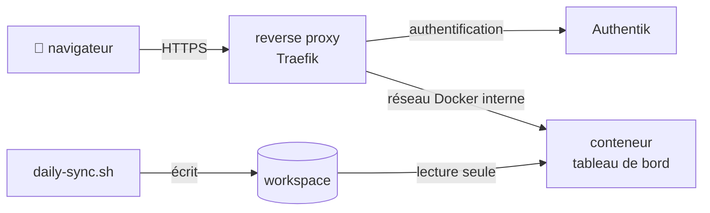

# Derrière un reverse proxy (Docker)

Si votre machine coach fait déjà tourner des services en conteneurs derrière un
reverse proxy — Traefik, avec une authentification unique (Authentik, Authelia) —,
le tableau de bord peut s'y ranger : une adresse comme `https://coach.example.org`,
ouverte depuis le téléphone après la connexion habituelle, au lieu d'un
[tunnel SSH](headless.md#sur-la-machine-coach-par-un-tunnel-ssh).

Le conteneur ne contient que le moteur (`scripts/`, `web/`, `config/`). Votre workspace
y est **monté en lecture seule** : le conteneur ne peut rien y écrire. L'index vit en
mémoire, se reconstruit au démarrage (quelques secondes pour quelques centaines de
fichiers) et se met à jour comme en local — un fichier écrit par la synchronisation
apparaît en moins de 30 secondes, sans redémarrer le conteneur.

!!! danger "Des données de santé, sans authentification propre"
    Le tableau de bord montre votre HRV, votre FC de repos, votre poids, vos verdicts
    médicaux. **Il n'a pas de connexion à lui** : c'est le reverse proxy qui protège
    l'accès. Le fichier compose fourni ne publie aucun port et refuse de démarrer sans
    middleware d'authentification. Ne contournez ni l'un ni l'autre.



## Lancé par `install.sh`

Le plus simple : laissez l'installeur s'en occuper. Quand Docker est présent, `./install.sh`
lancé dans un terminal propose une fois de servir le tableau de bord dans un conteneur (la
réponse, même « non », est mémorisée dans `[dashboard]`). Ou explicitement :

```bash
./install.sh --dashboard-docker local      # http://127.0.0.1:8765/, rien hors de la machine
./install.sh --dashboard-docker traefik    # derrière le Traefik de la machine
./install.sh --dashboard-docker traefik --dashboard-host coach.example.org --dashboard-auth authentik@file
./install.sh --dashboard-docker off        # arrête le conteneur lancé par install.sh
```

- **`local`** publie `127.0.0.1:<[dashboard].port>` seulement.
- **`traefik`** exige un conteneur Traefik en cours : son réseau et son point d'entrée sont
  détectés, l'adresse est demandée (défaut `coach.localhost`). Un middleware
  d'authentification est **obligatoire**, sauf si Traefik ne publie ses ports que sur
  `127.0.0.1` (rien n'est alors joignable hors de la machine).
- Le compose est généré dans `~/.config/ai-running-coach/dashboard/compose.yaml` (projet
  `arc-dashboard`), avec les mêmes garanties que ci-dessous (lecture seule, sans privilèges).
- Une relance de `./install.sh` garde le conteneur lancé mais **ne reconstruit jamais**
  l'image : c'est [`/update-coach`](../skills/update-coach.md) qui le fait, à chaque mise à
  jour du moteur.

Pour un déploiement exposé sur Internet avec Authentik ou un tunnel Cloudflare, le compose
fourni (`deploy/dashboard`, ci-dessous) reste la voie documentée.

## Mise en route

!!! tip "Préréglage `--preset docker` — prépare l'hôte, pas le conteneur"
    Cette page suppose que la machine coach existe déjà (c'est **sur elle**
    que se lance `docker compose`, pas sur une machine à part) :
    `./install.sh --preset docker` prépare cet hôte en configurant Claude
    Code (`--ide claude`, dont le runner de synchronisation a besoin) et en
    activant `--daily-sync` pour que le workspace monté par le conteneur
    reste à jour. L'authentification Garmin **reste active** (le conteneur,
    lui, ne parle jamais à Garmin — workspace monté en lecture seule — mais la
    synchronisation qui tourne sur l'hôte, oui) ; sans elle, la sync
    échouerait deux fois par jour faute de tokens. Pas de Remote Control,
    l'interface de cette machine étant le tableau de bord web. Voir
    [Préréglages](../quickstart.md#prereglages). Une option explicite reste
    prioritaire : ajoutez `--workspace DIR` si vos données vivent hors du
    dépôt du moteur. Le conteneur lui-même se lance toujours séparément,
    comme décrit plus bas (`docker compose up -d --build`) : le préréglage ne
    s'y substitue pas.

Sur la machine coach, dans le dépôt du moteur :

```bash
cd ~/ai-running-coach/deploy/dashboard
cp .env.example .env
```

Renseignez `.env` (il est ignoré par git) :

| Variable | Rôle |
|---|---|
| `ARC_DASHBOARD_HOST` | Nom public (`coach.example.org`). C'est aussi **le seul** en-tête `Host` que le serveur accepte : toute autre adresse reçoit un 403. |
| `ARC_WORKSPACE_HOST` | Chemin du workspace sur l'hôte, monté sur `/workspace` en lecture seule. |
| `ARC_UID`, `ARC_GID` | Propriétaire du workspace (`id -u`, `id -g`). `config/workspace.user.toml` est en mode 600 : un autre utilisateur ne pourrait pas le lire. |
| `TZ` | Fuseau horaire : il fixe « aujourd'hui ». |
| `TRAEFIK_NETWORK` | Réseau Docker sur lequel Traefik joint ses services. |
| `TRAEFIK_ENTRYPOINT` | Point d'entrée Traefik du routeur. |
| `TRAEFIK_AUTH_MIDDLEWARE` | **Obligatoire.** Middleware d'authentification déjà défini dans Traefik (`authentik@file`…). |
| `COMPOSE_FILE`, `AUTHENTIK_OUTPOST_SERVICE` | Avec Authentik uniquement : ajoutent la route de l'avant-poste (voir plus bas). |

Puis :

```bash
docker compose up -d --build
docker compose ps        # l'état passe à « healthy » en une trentaine de secondes
```

Les mises à jour suivantes passent par `scripts/update-docker.sh` (ci-dessous), qui
étiquette aussi chaque image avec la révision du dépôt.

## Mettre à jour

Vos fichiers sont lus en direct : une séance ou un plan écrit par le coach apparaît
sans rien toucher. L'image, elle, embarque le **code** du moteur, et le conteneur du
[chat](chat.md) garde en mémoire le code chargé à son démarrage : un simple
`docker restart` du tableau de bord garde l'ancienne version, il faut reconstruire **et**
recréer les deux.

Avec [`/update-coach`](../skills/update-coach.md), c'est automatique : à la fin de la mise
à jour, `scripts/update-docker.sh` reconstruit (`build --pull`) et relance chaque conteneur
en cours construit depuis le moteur ou l'un de ses dossiers — le tableau de bord (ce compose
ou celui d'`install.sh`) et le chat (`deploy/chat`) — puis attend qu'ils soient « healthy ».
Il le fait aussi quand le dépôt est déjà à jour mais qu'un conteneur tourne une révision
plus ancienne (un `git pull` fait à la main). Pensez seulement au `diff` du `.env`
ci-dessous quand une release ajoute une variable. Directement :

```bash
scripts/update-docker.sh --check # chaque conteneur tourne-t-il la révision du dépôt ?
scripts/update-docker.sh         # reconstruit, relance, attend « healthy »
```

Chaque image porte la révision git du dépôt (`org.opencontainers.image.revision`) :
`--check` la compare à `HEAD` (`à jour`, `ancienne version`, ou `révision inconnue` pour une
image construite à la main avec `docker compose up -d --build`, qui ne la reçoit pas).
Seules les images remplacées de ce projet sont supprimées. Après un `git pull` :

```bash
cd ~/ai-running-coach && git pull --ff-only
cd deploy/dashboard
diff <(grep -o '^[A-Z_]*=' .env.example | sort) <(grep -o '^[A-Z_]*=' .env | sort)
../../scripts/update-docker.sh
```

- `diff` signale une variable apparue dans `.env.example` et absente de votre `.env`
  (rien ne s'affiche si les deux concordent) ; `docker compose` refuserait de toute
  façon de démarrer sans une variable obligatoire.
- `--pull` récupère aussi la dernière image Python de base, et avec elle ses
  correctifs de sécurité.
- Faites-le en dehors des heures de synchronisation (07:15 et 14:15 par défaut) : la
  synchronisation lit le même dépôt du moteur.

**Revenir en arrière** : `git -C ~/ai-running-coach checkout <commit-précédent>` puis
`scripts/update-docker.sh` ; `git switch main` pour revenir ensuite à la version
courante.

## Exemple : Traefik, Authentik et un tunnel Cloudflare

Une configuration courante sur un serveur personnel : Cloudflare termine le HTTPS et
envoie le trafic par un tunnel (`cloudflared`) à Traefik, en HTTP sur le port 80 ;
Traefik vérifie la session auprès d'Authentik avant de transmettre.

### `.env`

```bash
ARC_DASHBOARD_HOST=coach.example.org
ARC_WORKSPACE_HOST=/home/moi/mon-workspace
ARC_UID=1000
ARC_GID=1000
TZ=Europe/Paris

TRAEFIK_NETWORK=traefik-network
# Le tunnel parle à Traefik en HTTP : même point d'entrée que vos autres services.
TRAEFIK_ENTRYPOINT=insecure
TRAEFIK_AUTH_MIDDLEWARE=authentik@file

COMPOSE_FILE=compose.yaml:compose.authentik.yaml
# Service Traefik (fournisseur file) qui pointe vers
# http://authentik:9000/outpost.goauthentik.io
AUTHENTIK_OUTPOST_SERVICE=sso@file
```

Reprenez les valeurs de vos services existants : le réseau, le point d'entrée et
les noms du middleware et du service de l'avant-poste sont ceux de votre
configuration Traefik.

`compose.authentik.yaml` ajoute un second routeur : les chemins
`/outpost.goauthentik.io/` du même hôte vont directement à l'avant-poste
d'Authentik. C'est par là qu'Authentik reçoit le retour de connexion.

### Authentik

Tout dépend du fournisseur *Proxy* qui protège vos services :

- **Forward auth (domain level)** : un seul fournisseur couvre tous les
  sous-domaines. Le nouveau nom est protégé d'office.
- **Forward auth (single application)** : un fournisseur par service. Créez un
  fournisseur *Proxy* dans ce mode, avec pour *External host*
  `https://coach.example.org`, une *Application* qui l'utilise, puis ajoutez
  l'application à l'avant-poste intégré (*Outposts* → *authentik Embedded Outpost*).

Dans les deux cas, **limitez l'application à votre compte** : liez-lui votre
utilisateur, ou un groupe qui ne contient que vous. Un compte invité de votre
Authentik, créé pour un autre service, n'a pas à voir vos données de santé.

### Cloudflare

Dans le tableau de bord Cloudflare, **Zero Trust → Networks → Tunnels** → votre
tunnel → **Public Hostname** → **Add a public hostname** :

| Champ | Valeur |
|---|---|
| Subdomain | `coach` |
| Domain | `example.org` |
| Type | `HTTP` |
| URL | la même que vos autres noms publics, par exemple `traefik` |

Cloudflare crée l'enregistrement DNS (un `CNAME` vers le tunnel). Rien d'autre à
ouvrir : aucun port de votre box n'est concerné.

Pour une seconde barrière, une application **Cloudflare Access** sur ce nom exige une
connexion chez Cloudflare avant même d'atteindre votre serveur.

### Sans Authentik

Supprimez les lignes `COMPOSE_FILE` et `AUTHENTIK_OUTPOST_SERVICE`, et nommez votre
propre middleware : `authelia@docker`, ou un `basicAuth` défini dans la
configuration dynamique de Traefik. Avec un point d'entrée HTTPS géré par Traefik,
`TRAEFIK_ENTRYPOINT=websecure` (le nom habituel).

## Images publiées (GHCR)

L'image du tableau de bord est aussi construite par la CI et publiée sur GitHub Container
Registry, pour `linux/amd64` et `linux/arm64` :
`ghcr.io/mmornati/ai-running-coach-dashboard`. Le compose ci-dessus la construit encore
localement ; l'image publiée prépare le passage à un simple `docker compose pull`.

| Étiquette | Contenu |
|---|---|
| `:latest` | La plus haute release stable. Jamais la tête de `main`. |
| `:X.Y.Z`, `:X.Y` | Une release (`:X.Y` suit son dernier correctif). |
| `:X.Y.Z-rc.N` | Une pré-version : jamais `:latest` ni `:X.Y`. |
| `:edge` | La tête de `main`, publiée seulement **après** le succès des tests (workflow *Tests*) sur ce commit. Pour tester avant une release. |
| `:sha-<7>` | Un commit précis (toutes les images en portent une). |
| `:branch-<nom>` | Une branche, publiée à la demande : Actions → *Publish images* → *Run workflow*. |

`:edge` ne reçoit donc jamais un commit dont les tests ont échoué : un serveur qui la
suit chaque nuit peut s'y fier. De même, *Tag a release* refuse de taguer `main` si le job
*Tests* n'a pas réussi sur le commit visé.

Chaque image porte la révision construite (`org.opencontainers.image.revision`), la même
que celle comparée par `scripts/update-docker.sh --check`, ainsi qu'une attestation de
provenance et un SBOM.

## Mode famille

Un seul conteneur de tableau de bord (et un seul de chat) peut servir **plusieurs athlètes**, chacun
dans son workspace, aiguillés par l'identité que pose Authentik (`X-authentik-username`) : voir
[Mode famille](../family.md). Deux compléments compose, à ajouter à `COMPOSE_FILE` :

| Fichier | Effet |
|---|---|
| `compose.family.yaml` | tableau de bord en `--family` ; registre (`ARC_FAMILY_FILE`) et dossier parent des workspaces (`ARC_FAMILY_ROOT`) montés aux mêmes chemins que sur l'hôte, **en lecture seule** |
| `compose.chat.family.yaml` (après `compose.chat.yaml`) | chat en `--family`, workspaces en **lecture-écriture** ; la route ntfy sans SSO accepte le `~` du jeton lié au membre |

Sans ces fichiers, rien ne change : le conteneur reste mono-athlète. Le registre exige
`[family].trusted_proxies` (le conteneur Traefik) : sans lui, le tableau de bord et le chat
refusent de démarrer. Redémarrez les deux conteneurs après chaque ajout de membre.

## Ce que garantit le conteneur

| Garantie | Comment |
|---|---|
| Rien n'est écrit dans vos fichiers | Workspace monté `:ro`, index en mémoire (`--memory`) |
| Rien n'est écrit dans le conteneur | `read_only: true`, seul `/tmp` est un tmpfs |
| Pas de privilèges | Utilisateur non root (`ARC_UID`), `cap_drop: ALL`, `no-new-privileges` |
| Pas d'accès direct | Aucun port publié : seul Traefik, sur son réseau, l'atteint |
| Pas d'accès sans connexion | Middleware d'authentification obligatoire, compose refuse de démarrer sans |
| Pas de *DNS rebinding* | Seul `ARC_DASHBOARD_HOST` est accepté ; le serveur refuse de démarrer s'il n'est pas déclaré |
| Lecture seule côté HTTP | `POST`, `PUT`, `DELETE`, `PATCH` → 405 |
| Contenu verrouillé | En-tête `Content-Security-Policy` strict, émis par le serveur ; seul l'hôte de `[dashboard].map_tiles` (tuiles de carte) y est ajouté aux images |

!!! note "En-têtes de sécurité ajoutés par le proxy"
    Si un middleware de votre point d'entrée définit lui-même
    `Content-Security-Policy` (`customResponseHeaders`), il remplace celle du tableau
    de bord, qui est plus stricte. Préférez un point d'entrée où ce n'est pas le cas.

La sonde `/healthz` sert au `HEALTHCHECK` de l'image ; elle ne réindexe rien.

Le serveur compresse ses réponses (gzip) et fait revalider le HTML, le CSS et le JS
par ETag (`304` quand rien n'a changé) : inutile de configurer une compression
côté proxy. Les réponses `/api/*` restent en `Cache-Control: no-store`.

## Dépannage

| Symptôme | Cause probable |
|---|---|
| `{"error": "hôte non autorisé"}` (403) | Le nom tapé dans le navigateur n'est pas `ARC_DASHBOARD_HOST`. |
| `404 page not found` de Traefik | Mauvais `TRAEFIK_NETWORK` ou `TRAEFIK_ENTRYPOINT` : comparez avec un service qui fonctionne. |
| Boucle de redirection, ou 404 après la connexion | La route de l'avant-poste manque (`COMPOSE_FILE`), ou Authentik ne connaît pas ce nom (fournisseur *single application*). |
| Le conteneur redémarre en boucle | `docker compose logs` : souvent `Permission denied` sur le workspace — `ARC_UID`/`ARC_GID` ne sont pas ceux du propriétaire. |
| « Aujourd'hui » bascule à 2 h du matin | `TZ` absent : le conteneur est en UTC. |

## Et sans Docker ?

`scripts/arc_serve.py` accepte `--listen` et `--allowed-host` (ou
`ARC_DASHBOARD_LISTEN` et `ARC_DASHBOARD_ALLOWED_HOSTS`) : c'est ce qu'utilise l'image.
Hors conteneur, `scripts/dashboard.sh` reste sur `127.0.0.1`. Pour une autre machine,
le [tunnel SSH](headless.md#sur-la-machine-coach-par-un-tunnel-ssh) est plus simple.
