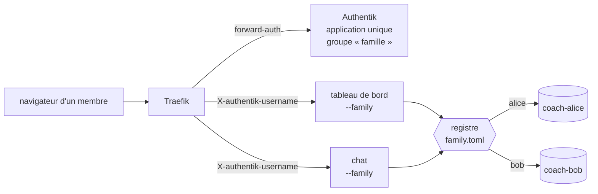

# Mode famille

Le mode famille fait tourner **toute la famille sur l'instance maison** : un seul
tableau de bord et un seul chat, mais **un dossier de données par personne**. Chacun se
connecte par la même page (Authentik), voit **son** coach et **ses** données, et
seulement les siennes.

!!! warning "Un mode maison, pas un service multi-utilisateur public"
    Les données de santé exigent un hébergement maîtrisé. Le mode famille s'adresse à un
    foyer derrière un reverse proxy authentifié, sur une machine que vous administrez.
    Ce n'est pas un hébergement multi-tenant ouvert au public.

Sans `--family`, **rien ne change** : le mode mono-athlète reste le comportement par
défaut, octet pour octet.

!!! warning "Prérequis : identifiants et planification par workspace (même épopée #127)"
    L'aiguillage du tableau de bord et du chat (cette page) est indépendant, mais **faire vivre
    plusieurs membres suppose la PR « identifiants et planification par workspace »** de l'épopée #127 :
    `install.sh --garmin-tokens DIR` et `--intervals-dir DIR`, un marqueur cron (et un label launchd) **par
    workspace**, et `ARC_LOCK_WORKSPACE=1` qui confine les scripts à leur workspace. **Tant qu'elle n'est pas
    fusionnée** : lancer `install.sh --daily-sync` pour un second workspace **remplace** la ligne cron du
    premier, et les jetons Garmin comme les identifiants intervals.icu restent **partagés** (un seul
    `~/.garminconnect`) ; la vérification `family_tokens` de `coach_doctor` le signale. Ne mettez qu'un
    seul athlète à synchroniser automatiquement avant cette PR.

## La décision : une application, une clé API, un dossier par membre

- **Une clé API Anthropic du foyer** alimente le chat et les synchronisations de tout le
  monde ([Choisir son IA](choisir-son-ia.md)). Plus besoin d'un compte Claude par membre ; le
  partage d'une clé API n'a pas le problème de conditions d'utilisation d'un abonnement
  claude.ai partagé.
- **Le chat web remplace Remote Control** comme canal de dialogue. Remote Control exige
  une connexion claude.ai et refuse de démarrer avec `ANTHROPIC_API_KEY` : il ne fait
  **pas partie du mode famille** (voir « Pour aller plus loin » plus bas).
- **Pas d'utilisateur Linux par membre.** La frontière entre membres devient :
  Authentik, l'aiguillage de l'application, et la
  [politique du chat](dashboard/chat.md), couverts par des tests d'isolation. Le chat est
  déjà confiné à un workspace : tout ce qui n'est pas explicitement permis est refusé,
  les chemins sont résolus (liens suivis) puis vérifiés **à l'intérieur** du workspace,
  le shell est limité à une liste blanche de scripts sans `--workspace`, et les motifs de
  secrets (`.garminconnect`, `*.env`, `*.token`…) sont bloqués. **Cette liste blanche ne suffit pas
  seule** : un script autorisé (`arc_index.py`, `arc_log.py`…) retrouve son workspace par `$ARC_WORKSPACE`
  ou par le pointeur `~/.config/ai-running-coach/workspace`, que le conteneur du chat hérite d'un autre
  membre. En mode famille, chaque backend (Claude, OpenCode, mock) lance donc ses processus enfants avec
  un environnement **explicite** : `ARC_WORKSPACE=<workspace du membre>`, `ARC_LOCK_WORKSPACE=1`, et
  `GARMINTOKENS` / `GARMIN_TOKENS_DIR` retirés (les jetons d'un membre viennent du `.mcp.json` de SON
  workspace). OpenCode ne lit pas non plus la configuration `~/.config/opencode` du compte système. Un
  test lance un vrai script autorisé avec l'environnement de Bob alors que l'environnement parent et le
  pointeur désignent Alice : il ne lit que Bob. `ARC_LOCK_WORKSPACE` n'est appliqué par les scripts qu'une
  fois la PR « identifiants et planification par workspace » fusionnée.



## Le registre `family.toml`

Par défaut `~/.config/ai-running-coach/family.toml`, ou le chemin donné par `--family`
ou `ARC_FAMILY`. Un exemple commenté : `deploy/dashboard/family.example.toml`.

```toml
[family]
trusted_proxies = ["traefik"]          # obligatoire : sans lui, les services refusent de démarrer
auth_header = "X-authentik-username"   # défaut
daily_budget_eur = 5.0                 # plafond de dépense du chat pour tout le foyer
allowed_hosts = ["coach.example.org"]
public_url = "https://coach.example.org"

[members.alice]
workspace = "/home/athlete/coachs/coach-alice"
display_name = "Alice"                 # facultatif

[members.bob]
workspace = "/home/athlete/coachs/coach-bob"
identities = ["Bob.Martin"]            # facultatif : autres valeurs possibles de l'en-tête
```

Validation au chargement (`python3 scripts/arc_family.py --family <registre>` pour la
lancer à la main) :

- l'identifiant d'un membre ne contient que `[a-z0-9_-]` ;
- chaque `workspace` est un chemin **absolu** vers un dossier **existant** ;
- aucun doublon, aucune imbrication entre deux workspaces (un workspace dans un autre
  exposerait l'un à l'autre) ;
- une identité (identifiant ou alias) ne désigne qu'un membre.

Dans l'application, aucun repli silencieux : le pointeur `~/.config/ai-running-coach/workspace`
n'est jamais consulté en mode famille.

### Comment l'identité est décidée

Le même code (`scripts/arc_family.py`) sert le tableau de bord et le chat. Pour chaque
requête de données :

1. l'adresse source doit appartenir à `trusted_proxies` (adresse, CIDR ou nom d'hôte, par
   exemple le conteneur Traefik) ; sinon **403**. Un en-tête d'identité écrit par un client
   quelconque est donc inopérant ;
2. l'en-tête d'identité (`auth_header`) doit être présent ; sinon **403** ;
3. sa valeur est cherchée **telle quelle** dans le registre (comparaison exacte, aucun
   texte de l'en-tête ne sert jamais à construire un chemin) ; inconnue : **403**.

Le refus est toujours le même message neutre : ni la raison précise, ni la liste des
membres ne sortent. `/healthz` et les fichiers statiques de l'interface restent anonymes
et ne contiennent aucune donnée.

## Lancer

=== "Sans Docker"

    ```bash
    python3 scripts/arc_serve.py --family ~/.config/ai-running-coach/family.toml
    python3 scripts/arc_chat.py  --family ~/.config/ai-running-coach/family.toml --listen 0.0.0.0
    ```

    `--family` exclut `--workspace`, et `--db` n'est pas permis avec `--family` (un index SQLite partagé
    mélangerait les membres : chacun a son index dans son workspace). Avec `ARC_FAMILY=<registre>` dans
    l'environnement et sans `--workspace`, le mode famille est aussi activé.

    Que mettre dans `[family].trusted_proxies` : l'adresse (ou le nom d'hôte) **du reverse proxy qui pose
    l'en-tête d'identité**, rien d'autre. Dans l'exemple ci-dessus, `--listen 0.0.0.0` n'a de sens que
    derrière ce proxy, et le chat refuse de démarrer hors boucle locale sans `[family].allowed_hosts` ou
    `public_url`.

    !!! danger "Ne faites pas confiance à `127.0.0.1` sans y réfléchir"
        Mettre `127.0.0.1` dans `trusted_proxies` (proxy local, tests) veut dire que **tout processus ou
        utilisateur local** de la machine peut s'écrire n'importe quelle identité (`curl -H
        'X-authentik-username: alice' …`) et lire les données d'Alice. À réserver à une machine
        mono-utilisateur dont le seul client local est le proxy.

=== "Docker (compose)"

    Ajoutez les deux compléments à `COMPOSE_FILE` (`deploy/dashboard/.env.example`) :

    ```bash
    COMPOSE_FILE=compose.yaml:compose.authentik.yaml:compose.chat.yaml:compose.family.yaml:compose.chat.family.yaml
    ARC_FAMILY_FILE=/home/athlete/.config/ai-running-coach/family.toml
    ARC_FAMILY_ROOT=/home/athlete/coachs
    ```

    - `compose.family.yaml` : le tableau de bord démarre en `--family`, avec le registre en
      lecture seule et le dossier parent des workspaces monté **aux mêmes chemins que sur
      l'hôte**, en lecture seule ;
    - `compose.chat.family.yaml` : le chat démarre en `--family`, avec les workspaces en
      **lecture-écriture** (le chat écrit dans `activities/`, `planning/`…) ;
    - `ARC_WORKSPACE_HOST` reste obligatoire dans `compose.yaml` ; en mode famille il peut
      valoir `ARC_FAMILY_ROOT` (il n'est pas servi).

    Les jetons ntfy portent le membre (`<membre>~<id>.<secret>`) : le complément du chat élargit
    d'un `~` le filtre de la route sans SSO. Si vous avez recopié la route dans votre propre
    configuration Traefik (`deploy/chat/traefik/dynamic.yml`), faites la même modification.

Détails Docker : [Derrière un reverse proxy](dashboard/docker.md#mode-famille).

## Ce que le mode famille garantit

**Tableau de bord** (`arc_serve.py --family`)

- un index (`Store`) **par membre**, ouvert à la première requête de ce membre ;
  `--memory` et le rafraîchissement périodique s'appliquent à chacun ;
- toutes les routes `/api/*` et `/media/*` passent par l'identité *avant* tout aiguillage :
  une route ajoutée plus tard sans résolution d'identité n'existe simplement pas côté
  données (un test énumère la table des routes) ;
- `/api/whoami` renvoie l'identifiant et le nom affiché du membre connecté.

**Chat** (`arc_chat.py --family`)

- un `ChatService` **par membre** : son backend (instance propre), sa politique, ses
  sessions, sa dépense et ses réglages ntfy, lus dans **son** workspace ;
- les **jetons d'approbation ntfy** contiennent le membre et celui-ci entre dans leur
  empreinte : le lien de A est inutilisable pour B, même rejoué avec un autre préfixe ;
- une **dépense à deux étages** : le budget `[chat].daily_budget_eur` de chaque membre **et** un
  plafond du foyer (`[family].daily_budget_eur`). Le plus bas des deux s'applique à chaque tour, et les
  réservations des tours en cours de **tous** les membres sont tenues sous un seul verrou (deux membres
  qui parlent en même temps ne peuvent pas dépasser ensemble le plafond) ; `/api/chat/status` donne le
  reste effectif (`budget.remaining_eur`) ;
- un membre dont la configuration est cassée est indisponible (503) sans affecter les autres ;
- `/healthz` (boucle locale) ne renvoie que `{"ok": true, "members": <nombre>}`.

**Isolation testée** : `tests/data/test_family_isolation.py` construit deux vrais workspaces
indexés et vérifie, pour chaque route du tableau de bord et du chat, que l'en-tête de A ne
renvoie jamais de donnée de B ; qu'un utilisateur inconnu reçoit 403 ; qu'un en-tête
usurpé depuis une adresse hors `trusted_proxies` est refusé ; que le jeton d'approbation de
A est inutilisable pour B ; que la politique du chat de A refuse tout chemin du workspace
de B.

## Ajouter un membre (liste de contrôle)

1. **Créer son dépôt privé** et lancer
   `./install.sh --workspace <dossier> --source <garmin|intervals> --garmin-tokens <dossier de jetons>`
   (selon la source de données ; `--garmin-tokens` vient de la PR « identifiants et planification par
   workspace » — sans elle, les jetons Garmin restent dans `~/.garminconnect`, partagés).
2. **Brancher sa source de données**
    - Garmin : `garmin-mcp-auth` vers **son** dossier de jetons, avec son compte (MFA).
      Le conteneur du chat ne voit que les dossiers montés : un sous-dossier de
      `~/.garminconnect/` (`~/.garminconnect/<membre>`) est déjà monté par `compose.chat.yaml`.
    - Apple Watch ou autre : son compte intervals.icu et sa clé API, les passerelles iOS
      ([Apple Watch](apple-watch.md)), une semaine d'observation. Vérifier qu'un FIT HealthFit se
      télécharge par `download_fit.py <id intervals>`.
3. **Remplir son `config/workspace.user.toml`**
    - `[sync]` : `mode = "watch"` (Garmin) ou `"schedule"` (intervals.icu) ;
    - `[notifications]` : un **topic ntfy distinct** ;
    - `[chat]` : `daily_budget_eur`.
4. **Planifier sa synchronisation** — *requiert la PR « identifiants et planification par workspace »* :
   chaque membre a sa propre entrée, `./install.sh --workspace <dossier> --daily-sync`, marquée par
   son workspace (cron et launchd), de sorte que les lignes de plusieurs workspaces coexistent ; ses
   identifiants sont ceux de son workspace (`--garmin-tokens DIR`, `--intervals-dir DIR`). Horaires à
   décaler pour ménager la limitation de débit de Garmin. **Sans cette PR**, la commande remplacerait
   la ligne cron du membre précédent et les jetons seraient partagés : ne synchronisez alors qu'un seul
   workspace automatiquement.
5. **L'ajouter** à `family.toml` et au groupe Authentik « famille », puis **redémarrer les deux
   conteneurs** (le registre est lu au démarrage).
6. **Première connexion** : dans le chat, `/coach-setup` (son profil, son objectif).
7. **Vérifier**
    - il ne voit que son tableau de bord ;
    - son premier `medical/*_health.md` est correct (« readiness indisponible » pour
      intervals.icu) ;
    - sa synchronisation tourne avec **ses** identifiants ;
    - `python3 scripts/coach_doctor.py` est au vert (voir ci-dessous).

## Authentik : une seule application

Une **seule application** Authentik (fournisseur *forward auth*, application unique) protège
`coach.example.org`, **limitée au groupe « famille »** : ajouter ou retirer un membre du groupe
suffit à lui ouvrir ou fermer l'accès. L'en-tête transmis à l'application est
`X-authentik-username` ; si le nom d'utilisateur Authentik n'est pas un identifiant valide du registre
(majuscules, point…), déclarez-le dans `identities`.

Mise en place du proxy, de l'avant-poste et de Traefik :
[Derrière un reverse proxy](dashboard/docker.md#exemple-traefik-authentik-et-un-tunnel-cloudflare).

## `coach_doctor` en mode famille

Quand le registre est donné **explicitement** (`--family <registre>` ou `ARC_FAMILY`),
`scripts/coach_doctor.py` ajoute quatre vérifications à sa sortie (le reste du schéma JSON est
inchangé). Le registre n'est jamais cherché tout seul, et **rien n'est ajouté sous
`ARC_LOCK_WORKSPACE=1`** ni avec `--check` : un doctor lancé depuis le chat d'un membre ne doit pas décrire
les autres (liste des membres, dossiers de jetons, planifications). À lancer par l'administrateur, hors du
chat :

| Vérification | Alerte quand… |
|---|---|
| `family_registry` | le registre est invalide (erreur) |
| `family_tokens` | deux membres en source Garmin partagent le même dossier de jetons (avertissement) |
| `family_ntfy` | deux membres utilisent le même topic ntfy (avertissement) |
| `family_sync` | une synchronisation planifiée n'est pas détectée pour un membre (information) |

Le dossier de jetons de chaque membre est résolu comme pour la vérification classique
(`GARMINTOKENS` du `.mcp.json` du workspace, puis variables d'environnement, puis
`~/.garminconnect`) : sans la PR « identifiants et planification par workspace », deux membres Garmin
tombent tous deux sur `~/.garminconnect` et l'avertissement `family_tokens` est attendu.

## Limites d'isolation

!!! danger "À lire avant de s'y fier"
    - **L'administrateur de la machine peut tout lire.** Quiconque a un shell sous l'UID du service
      (ou les droits sur les workspaces) lit les données de tous les membres. Le mode famille
      protège les membres **entre eux, dans l'application** — pas contre l'administrateur.
    - **Même UID, même processus.** Un bug d'aiguillage exposerait les données d'un autre membre. Pour
      une famille derrière Authentik, c'est un risque accepté **à condition** des garde-fous
      ci-dessus et de leurs tests d'isolation ; relancez-les (`python3 tests/run_tests.py --tier d`)
      après toute mise à jour du moteur.
    - **Le proxy est la racine de confiance.** Si `trusted_proxies` est trop large, ou si un service
      peut joindre le tableau de bord sans passer par le forward-auth, l'en-tête d'identité peut être
      forgé. Ne publiez aucun port du tableau de bord ou du chat.
    - **Une seule clé API** pour tout le foyer : le plafond du foyer limite la dépense, il
      n'isole pas les usages.

### Données des mineurs

Pour les données de santé des enfants, préférez un **remote git hébergé à la maison**
(ou `git_autocommit = false`) plutôt que GitHub, même en dépôt privé
([Votre workspace privé](workspace.md#versionner-automatiquement-depuis-la-machine-coach)).

## Mises à jour du moteur

Un `git pull` du moteur profite à **tous** les membres. Relancez
`./install.sh --workspace <dossier>` pour **chaque** membre quand un agent ou un skill est
**ajouté** : le catalogue de liens est figé à l'installation.

## Pour aller plus loin

- **Remote Control** (`coach-remote.sh`) n'est pas disponible en mode famille : il exige une
  connexion claude.ai personnelle et refuse la clé API. Un membre qui le veut peut avoir son
  propre abonnement et son propre utilisateur Linux : l'isolation par l'OS (un utilisateur
  par membre, une pile par membre, un hôte par membre) reste possible, hors de ce mode.
- Une vue famille agrégée (volumes hebdomadaires côte à côte), en lecture seule et réservée à un
  groupe Authentik « admin », n'est pas implémentée.
- Membre sans Garmin : [Apple Watch](apple-watch.md). Les sources peuvent se mélanger (un
  workspace `garmin`, un workspace `intervals`).
