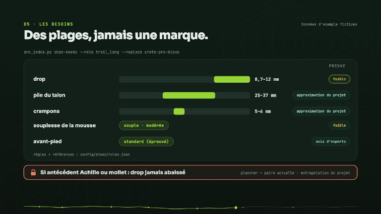

# Choisir ses chaussures

Épopée #297. Le suivi des chaussures (kilométrage, inspection photo, bilan de carrière) dit **ce que
vous avez porté** ; choisir la prochaine paire demande de savoir **ce qu'elle est**. Cette page décrit les
briques dans l'ordre : la fiche de caractéristiques d'une paire (#298), les retours de chaussant (#299), le profil
d'usage (#300), les besoins pour la prochaine paire fondés sur les preuves (#301) et la commande `/shoes` qui assemble
le tout (#302). Une paire retirée dans Garmin Connect est retirée aussitôt du suivi : voir [Configuration Garmin](garmin-setup.md).

<!-- arc-video:paire-suivante -->
<div class="arc-video-card" markdown>

[](video/paire-suivante/index.html)

<div markdown>

<span class="arc-video__meta">En vidéo · Étape 23 · 1 min 38</span>

**[La paire suivante](video/paire-suivante/index.html)** — Une paire arrive en fin de vie : fiche de caractéristiques sourcée, retours de chaussant, profil d'usage, plages cibles par des règles à preuves et commande /shoes (continuité d'abord, veto médical, confort qui décide) — sans achat, sans prix, sans promesse de prévention.

[Regarder](video/paire-suivante/index.html) · [English](video/paire-suivante/index.html?lang=en) · [Toutes les vidéos](videos.md)

</div>

</div>
<!-- /arc-video -->

## La fiche de caractéristiques : `gear/specs/<gear_id>.md`

Un fichier par paire, lié au profil par le `gear_id` (le profil `### Chaussures` reste inchangé et édité
par vous). Il s'ouvre par un bloc `arc` de type `shoe_spec`, comme les autres fichiers du workspace ;
le texte libre dessous garde la version retenue et le journal des validations.

| Champ | Contenu |
|---|---|
| `brand`, `model`, `version`, `release_year` | identité exacte de la paire |
| `size`, `purchase_date` | pointure (valeur + système) et date d'achat |
| `category` | `road`, `trail` ou `hybrid` |
| `drop_mm`, `stack_heel_mm`, `stack_forefoot_mm` | géométrie en millimètres |
| `weight_g` | poids en grammes (+ `reference_size`, la pointure du poids annoncé) |
| `midsole_foam`, `midsole_softness` | mousse (EVA, PEBA, TPU…) et dureté (valeur + échelle, ex. Asker C) |
| `plate` | `none`, `carbon`, `nylon`, `rock_plate` |
| `lug_depth_mm`, `toe_box` | crampons et largeur d'avant-pied (`narrow`, `standard`, `wide`) |
| `flexibility_longitudinal`, `flexibility_torsional`, `stability_devices` | évaluations manuelles pour l'index minimaliste |

Une caractéristique introuvable est **absente** du fichier : jamais estimée, jamais reprise d'un modèle
voisin (une valeur d'un modèle voisin peut être montrée en séance comme indice, jamais enregistrée).

### La provenance de chaque valeur

Chaque champ est un objet, pas un nombre nu :

```json
"drop_mm": {
  "value": 8.7, "source_type": "measured",
  "url": "https://www.rtings.com/running-shoes/reviews/kiprun/kipride-max", "retrieved": "2026-10-12",
  "alternatives": [{"value": 6, "source_type": "manufacturer", "url": "…", "retrieved": "2026-10-12"}]
}
```

- `source_type` : `measured` (laboratoire), `manufacturer` (marque ou revendeur qui la recopie) ou `athlete` (vous).
- `value` est la valeur **retenue** : **une mesure prime sur la marque** ; votre propre correction, validée
  ligne par ligne, prime sur les deux. Les autres sources vont dans `alternatives`.
- `url` et `retrieved` (date de consultation) sont obligatoires pour `measured` et `manufacturer`.
- Valeurs plausibles, sinon la fiche est refusée : drop de -5 à 20 mm, piles de 0 à 60 mm, poids de 100 à
  600 g, crampons de 0 à 12 mm. Une source **alternative** qui s'éloigne trop de la valeur retenue (poids
  de plus de 25 %, cotes de plus de 4 à 6 mm) déclenche un avertissement d'**aberration probable** (par
  exemple un poids de 580 g face à des 240-285 g) ; confirmée, elle est conservée pour mémoire avec
  `outlier: true` et n'est jamais retenue. L'écart marque/laboratoire sur le drop, lui, n'est pas une
  aberration : c'est une information, et il reste visible.

### La saisie assistée

Voir le skill [`shoe-specs`](skills/shoe-specs.md) : questions, identification de la version
(date de lancement face à date d'achat, sinon on demande), recherche web **à la demande** (laboratoire,
puis marque, puis un ou deux revendeurs ; pas de scraping), tableau de validation, et écriture
seulement après votre validation ligne par ligne. Jamais en headless.

### Lire les fiches

```bash
python3 scripts/arc_index.py shoe-specs                       # JSON : toutes les fiches + paires sans fiche
python3 scripts/arc_index.py shoe-specs --gear kipride-max-1 --text
```

Lecture seule. Par champ : la valeur retenue et sa source, les alternatives, l'écart entre sources
(`spread`, dont `measured_minus_manufacturer`, l'écart laboratoire - marque) et, pour une valeur que vous avez
choisie, `basis` (la source sur laquelle vous vous êtes fondé) ; par fiche : les champs absents, `in_profile`
(`false` si la paire n'est pas dans `### Chaussures`) et l'index minimaliste. **Une seule fiche par paire** :
le fichier s'appelle exactement `<gear_id>.md`, sinon il n'est pas indexé.

Si vous préférez la valeur de la marque à la mesure d'un laboratoire, la fiche la garde sans contredire la
règle « la mesure prime » : valeur retenue en `athlete` avec `basis: manufacturer` et l'URL de la marque, la
mesure et la valeur de la marque restant en `alternatives`.

## L'index minimaliste (Esculier et al. 2015)

Source : Esculier et al. 2015, *J Foot Ankle Res* 8:42
([article](https://jfootankleres.biomedcentral.com/articles/10.1186/s13047-015-0094-5), PMC4543477 ; la
grille de notation est le fichier additionnel 1 de l'article). Cinq sous-échelles de 0 à 5 (5 = plus
minimaliste) ; l'index est la somme multipliée par 4, soit un pourcentage sur 25 points.

| Sous-échelle | 5 | 4 | 3 | 2 | 1 | 0 |
|---|---|---|---|---|---|---|
| Poids | < 125 g | 125 à < 175 g | 175 à < 225 g | 225 à < 275 g | 275 à < 325 g | ≥ 325 g |
| Hauteur de talon (pile) | < 8 mm | 8 à < 14 mm | 14 à < 20 mm | 20 à < 26 mm | 26 à < 32 mm | ≥ 32 mm |
| Drop | < 1 mm | 1 à < 4 mm | 4 à < 7 mm | 7 à < 10 mm | 10 à < 13 mm | ≥ 13 mm |
| Dispositifs de stabilité / contrôle du mouvement | aucun | 1 | 2 | 3 | 4 | 5 ou 6 |
| Flexibilité | somme de deux notes : longitudinale (0 à 2,5) + torsionnelle (0 à 2,5), par pas de 0,5 | | | | | |

Dispositifs comptés : semelle intermédiaire multi-densité, ponton médial thermoplastique, contrefort de
talon rigide, voûte médiale surélevée, tige médiale tendue, évasement médial.

Ce qui vient de la fiche : poids, pile du talon et drop (le drop vient de `drop_mm`, sinon de la pile du
talon moins la pile de l'avant-pied). La flexibilité et les dispositifs de stabilité **n'existent chez
aucune source en ligne** : ce sont des évaluations manuelles de votre part, saisies en
`flexibility_longitudinal`, `flexibility_torsional` et `stability_devices` avec la source `athlete`.
Si une entrée manque, l'index est **indisponible et la commande en donne la raison** — jamais une valeur
partielle. L'index n'est pas enregistré dans la fiche : il est recalculé à chaque lecture.

Limites, dites plutôt que cachées : l'article mesure le poids de la chaussure et la pile au pied à
coulisse sous le talon et les têtes métatarsiennes ; une valeur de marque ou de laboratoire en est une
**approximation du projet** (pointure de référence, point de mesure). Le poids dépend de la pointure : l'article
évalue des chaussures en « US men's size 9 » (soit UK 8, EU 42,5), et ses évaluateurs mesurent avec la semelle
intérieure en place, alors que les chiffres de marque l'excluent le plus souvent. La commande ajoute un
avertissement `warnings` quand `reference_size` manque, est ambiguë (un « 9 » seul) ou diffère de US M9, UK 8 ou
EU 42,5, et rend toujours les `assumptions` de la méthode. L'index sert à situer un
**changement** entre deux paires, pas à juger une chaussure, et ce n'est pas un avis médical.

## Retours de chaussant et bilan de retraite

Le confort perçu est le critère individuel le mieux étayé pour choisir une chaussure (Nigg 2015,
Malisoux 2025, voir [l'épopée #297](https://github.com/mmornati/ai-running-coach/issues/297)) : il faut
donc l'enregistrer. Rien de tout cela n'est un avis médical.

### Un retour par séance : `/log`

Une phrase suffit : « Kipride : ampoule au talon gauche, avant-pied serré, confort 6 ». Le modèle
extrait les termes ; `scripts/arc_log.py` les rattache à une **liste fermée** et écrit, dans le bloc `arc`
de la séance, `shoe_feedback` = `{comfort, issues[], notes}` :

| `issues[].kind` | Se dit (exemples) |
|---|---|
| `blister` | ampoule, cloque |
| `toe_box_tight` | avant-pied serré, orteils à l'étroit |
| `heel_slip` | talon qui bouge, qui glisse |
| `hot_spot` | point chaud, échauffement, frottement |
| `numbness` | engourdissement, pied qui s'endort |
| `lacing_pressure` | laçage trop serré, pression des lacets |
| `instability` | instable, manque de stabilité |
| `too_soft` / `too_firm` | trop mou / trop dur |
| `poor_grip` | manque d'adhérence |
| `upper_tear` | tige déchirée |

Les pluriels, féminins, articles et intensificateurs sont tolérés (« ampoules », « trop dures », « mes
Kipride ») ; une **négation** (« pas d'ampoule », « sans frottement », « pas de souci ») n'écrit jamais de problème.

`zone` (facultatif) reprend les zones des inspections photo (`heel_lateral`, `forefoot_central`, `toe`…) et
`side` vaut `left` ou `right`. Un terme hors liste, une zone vague (« sous le pied ») ou un confort hors de
0-10 déclenchent une **question**, jamais une devinette. Le retour est **rattaché à la paire de la
séance** : une séance sans `gear_id` fait demander la paire avant d'écrire (la paire « par défaut » n'est
jamais supposée), et le contrat refuse un `shoe_feedback` sans `gear_id`.

Garde-fous : un retour de chaussant **ne remplace jamais** la douleur. « Ampoule au talon et douleur 7/10 »
écrit `shoe_feedback` **et** `pain`, avec la recommandation de consultation dès
`[injury_risk].pain_consult_threshold` ; l'ampoule n'est jamais présentée comme la cause de la douleur
(ni l'inverse).

### Le bilan de retraite d'une paire

Quand une paire passe à `(retirée)`, le coach **propose** (une fois, jamais en headless) de la noter :
`comfort_overall` de 0 à 10, `would_rebuy` (`yes` | `yes_with_change` | `no`) et, pour `yes_with_change`,
`change_wanted` parmi `wider_toe_box`, `narrower`, `more_drop`, `less_drop`, `more_cushion`, `firmer`,
`more_grip`, `lighter`, `more_stable`, `other`, plus un mot libre. Il est stocké comme objet `verdict` de
la fiche `gear/specs/<gear_id>.md` : une paire reste décrite par un seul fichier de référence (voir
[le contrat de données](skills/workspace-data-contract.md)).
Si la paire n'a pas de fiche, le coach propose de la créer d'abord, sans inventer de caractéristique.

### Lire les retours

```bash
python3 scripts/arc_index.py shoe-feedback                       # JSON : toutes les paires
python3 scripts/arc_index.py shoe-feedback --gear kipride-max-1 --text
```

Lecture seule. Par paire : nombre de séances avec retour, confort (moyenne, min, max, dernier), problèmes
comptés par `kind` et par zone (en nombre de **séances** touchées), retours récents, bilan de retraite. Les chiffres sont **déclaratifs** :
corrélation, pas causalité. Les boutons Telegram « confort » après une séance ne font pas partie de cette
étape.

## Profil d'usage d'une paire

Pour remplacer une paire, il faut savoir **à quoi elle servait réellement**.

```bash
python3 scripts/arc_index.py shoe-usage                       # JSON : toutes les paires
python3 scripts/arc_index.py shoe-usage --gear kipride-max-1 --text
```

Lecture seule, calculé à la lecture (aucune table, rien d'écrit). Le même profil sert la fiche d'une paire
du tableau de bord (carte « Usage », [vue Matériel](dashboard/views.md#fiche-dune-paire-ou-dun-objet)).
Les séances sont **exactement** celles du kilométrage : la règle d'attribution est unique.

| Bloc | Contenu |
|---|---|
| **Usage** | part route / trail (km et séances), D+/km et D−/km, distribution des distances, sorties longues (durée > 90 min), courses (intensité planifiée `race`), allure et GAP moyens, part de séances humides, période d'utilisation |
| **Foulée** | temps de contact, oscillation et ratio verticaux, longueur de pas, balance, cadence, **par tranche d'allure** |
| **Retours et douleurs** | synthèse des retours de chaussant (voir plus haut), épisodes de douleur, séances sans paire |
| **Usure** | dernière inspection (état, asymétrie, indices) |
| **Rôle déduit** | `race`, `trail_long`, `trail`, `road_tempo`, `road_easy`, `mixed_long`, `mixed`, `insufficient_data` |

Toute grandeur sans donnée est **omise** (jamais 0). D+/km et D−/km ne portent que sur les séances qui ont le
dénivelé : la couverture (`elevation_sessions`, `elevation_distance_m`) est affichée. La période d'usage court
jusqu'à aujourd'hui pour une paire active, jusqu'à sa dernière séance pour une paire retirée. Les seuils ci-dessous sont des **approximations du projet**,
pas des seuils cités d'une source.

### Foulée à allure comparable

Une paire « rapide » aurait mécaniquement un temps de contact plus court : les paires ne sont donc comparées
que **dans la même tranche d'allure**.

- Tranches de **30 s/km**, ancrées sur des multiples de 30 (5:00–5:30/km, 5:30–6:00/km…).
- Allure de la tranche : l'allure GAP de la séance si elle existe, sinon l'allure brute. Les deux bases ne
  sont jamais mélangées dans une même tranche (la base est affichée).
- Valeur d'une paire dans une tranche : moyenne des moyennes de séance (`arc_gait.resolve_session`) — chaque
  moyenne porte sur TOUTE la séance (intervalles, marche et échauffement compris) : approximation du projet.
- **Effectif minimal : 3 séances par tranche et par grandeur**, sinon « données insuffisantes » (pas de
  moyenne, pas de comparaison). Les autres paires ne sont listées que si elles atteignent aussi l'effectif
  dans la même tranche.

### Douleurs : corrélation, pas causalité

- Un **épisode** est une zone douloureuse déclarée (`health.pain`, score > 0) ; les jours consécutifs d'une même
  zone forment un seul épisode.
- Il est rattaché à la séance de course **la plus récente avec paire, datée de 0 à 2 jours avant son début** (≤ 48 h à la
  granularité du jour ; le même jour compte, l'heure de la douleur étant inconnue). Plusieurs paires (ou une
  séance sans paire) dans la fenêtre : l'épisode est marqué `ambiguous`. Le compte global des épisodes non
  rattachés est donné une fois en tête de rapport ; chaque paire ne compte que ceux de sa période d'usage.
- En jours entiers, « ≤ 48 h » couvre en pratique jusqu'à environ 72 h (approximation du projet).
- Les épisodes sans séance de course dans la fenêtre, ou dont la séance n'a pas de paire, sont rattachés à
  aucune paire mais **comptés et affichés** (`unattributable_episodes`).
- Rapportés à l'**exposition** (km et séances de la paire) : par 100 km et par 100 séances, **à partir de
  5 épisodes seulement** (même seuil que `decision-effects`) ; en dessous, comptes bruts et exposition, sans taux
  ni tendance.
- Les **séances de course sans `gear_id`** sur la période d'usage de la paire sont comptées et signalées : tant
  qu'il y en a, le lien douleur ↔ paire n'est pas fiable. Celles créditées à la paire par défaut sont
  comptées à part, comme une hypothèse.
- Jamais un diagnostic, jamais une cause : ce n'est pas un avis médical.

### Rôle déduit

Règles appliquées dans l'ordre, sur les séances de course à pied de la paire :

1. `race` : au moins 2 séances dont au moins la moitié sont des courses ;
2. `insufficient_data` : moins de 5 séances ;
3. `trail_long` : au moins 70 % des km en trail et au moins 25 % de sorties longues ;
4. `trail` : au moins 70 % des km en trail ;
5. `road_tempo` : au moins 70 % des km sur route et allure moyenne au moins 5 % plus rapide que la moyenne route
   de l'athlète (toutes paires confondues) ;
6. `road_easy` : au moins 70 % des km sur route ;
7. `mixed_long` : aucun terrain à 70 % mais au moins 25 % de sorties longues (paire polyvalente des longues) ;
8. `mixed` sinon.

Le rôle est une entrée pour la recommandation (story #301), jamais une prescription.

## Besoins pour la prochaine paire

```bash
python3 scripts/arc_index.py shoe-needs --role trail --replace trail-a          # JSON
python3 scripts/arc_index.py shoe-needs --role road_tempo --replace road-a --text
```

Rôles : `trail_long`, `trail`, `road_easy`, `road_tempo`, `race`, `mixed_long`, `mixed` (le vocabulaire du rôle déduit,
voir plus haut). Lecture seule et **déterministe** : mêmes données, même sortie. La commande rend des
**plages cibles**, jamais un nom de marque ni de modèle :

| Cible | Valeurs |
|---|---|
| `drop_mm`, `stack_heel_mm`, `lug_depth_mm`, `minimalist_index_pct` | `min` / `max` |
| `midsole_softness` | `soft`, `moderate`, `firm` |
| `toe_box` | `narrow`, `standard`, `wide` |
| `plate` | `none`, `carbon`, `nylon`, `rock_plate` |

Chaque cible porte les règles appliquées (`rules`), leurs raisons en français, le niveau de preuve de la
règle la plus faible qui la contraint (`confidence`) et les références. S'y ajoutent des **options**
(plaque de performance, plaque anti-roche, stabilité), des **rappels** (rotation), des **avertissements**
et des **notes** (ce qui n'a pas pu être calculé, et pourquoi). Les règles vivent dans
[`config/shoes/rules.json`](https://github.com/mmornati/ai-running-coach/blob/main/config/shoes/rules.json) :
chacune a un identifiant, une condition, un effet, un niveau de preuve (`high`, `moderate`, `low`,
`expert_opinion`, `none`) et des références ; un niveau `none` ou `expert_opinion` doit justifier l'absence
de preuve (`rationale`).

Ordre de décision : **confort, puis continuité, puis garde-fous blessures, puis adéquation au terrain.**

1. **Confort d'abord.** La référence est l'ensemble des paires avec `would_rebuy = yes` **ou
   `yes_with_change`** (le changement souhaité est alors appliqué) et un confort d'au moins 7/10 (bilan de
   retraite, sinon moyenne des retours). Sans paire de référence, le moteur garde des **plages larges** et
   écrit « données insuffisantes » : il ne devine rien. Si la paire remplacée a une fiche mais pas de
   verdict de confort, il affiche seulement une **bande de continuité indicative** (drop, pile, index
   minimaliste), étiquetée « paire remplacée, sans verdict de confort » : un avertissement, jamais une
   contrainte.
2. **Continuité.** Drop à +/- 4 mm de la référence (la valeur **mesurée** prime sur celle de la marque),
   index minimaliste à +/- 20 points, pile du talon à +/- 6 mm et crampons à +/- 1 mm (ces deux derniers
   écarts sont des approximations du projet), largeur d'avant-pied déjà éprouvée.
3. **Garde-fous.** Antécédent de douleur au tendon d'Achille ou au mollet : **le drop n'est pas abaissé**
   (extrapolation du projet : l'essai sur le drop n'a aucune donnée propre à l'Achille). Entorse de cheville
   déclarée au profil, ou au moins deux épisodes de douleur à la cheville d'au moins 4/10 **du même côté** :
   pile du talon au plus égale à celle de la paire actuelle et base large (avis d'experts). Masse au-dessus
   de 71,4 kg : pas de pas vers plus de minimalisme (niveau faible : sous-groupe d'un seul essai). La masse
   ne relève **jamais** l'amorti.
4. **Terrain.** Route : crampons de 4 mm au plus. Trail avec des indices de terrain meuble (au moins 30 %
   de séances humides, ou D+/km d'au moins 40 m) : crampons de 5 mm au moins. L'usage d'une paire ne
   distingue que route et trail : **ni la boue ni la roche ne sont détectées**, la pluie et le dénivelé
   sont des substituts (approximation du projet) et la plaque anti-roche reste une option à confirmer.

Le bilan de retraite (`yes_with_change` + `change_wanted`) décale la plage correspondante (largeur, drop,
amorti, adhérence, stabilité) ; un garde-fou de blessure prime toujours sur cette préférence. Une course
(`race` ou `road_tempo`) ajoute la plaque et la mousse haute performance comme **option de performance**.
**Antécédents lus.** Le moteur lit (1) les douleurs déclarées de `medical/` et (2) les puces du profil
« Antécédents de blessure » et « Zones fragiles à surveiller » ; les zones sont normalisées comme pour la
prévention ciblée (« tendon d'Achille gauche », « cheville droite (proprioception) »). La sortie (JSON et
`--text`) dit toujours quelles sources ont été lues, sur quelle période et combien d'entrées elles ont
donné ; sans antécédent, elle écrit « aucun antécédent trouvé » avec ces sources. Un élément du profil sans
zone reconnue est signalé, jamais deviné. Une douleur à la cheville n'est dite « entorse » que si le profil
la déclare comme telle. Le terrain d'un rôle `race`, `mixed` ou `mixed_long` vient de l'**usage** de la paire
remplacée, pas de la course visée : le moteur le dit.

## Choisir la prochaine paire : `/shoes`

```text
/shoes            # le rôle de la paire en fin de vie
/shoes trail      # un rôle précis (ou le nom d'une paire à remplacer)
```

Le skill [`shoes`](skills/shoes.md) désigne le rôle, puis [`shoe-selection`](skills/shoe-selection.md) mène
la conversation. Il ne calcule rien : les plages viennent de `shoe-needs`, l'historique de la paire de
`shoe-specs`, `shoe-feedback` et `shoe-usage`. Interactif uniquement, jamais pendant la synchronisation
automatique.

1. **Le rôle.** Sans argument, celui de la paire non retirée qui arrive en fin de vie : seuil d'alerte franchi
   ou dernière inspection 🔴. S'il y en a plusieurs, ou aucune, le coach demande ; il ne devine pas.
2. **La continuité d'abord.** Si la paire remplacée a `would_rebuy = yes`, un confort d'au moins 7/10 et
   aucun problème de chaussant attribué, le coach propose **la version actuelle du même modèle** et la
   **compare toujours** à l'ancienne, ligne à ligne : les marques changent le drop, la pile ou le chaussant
   d'une version à l'autre. Avec `yes_with_change`, c'est le modèle le plus proche qui corrige le point demandé
   (par exemple un avant-pied plus large).
3. **Sinon, les plages puis la recherche.** Les plages cibles de `shoe-needs`, puis 3 à 5 modèles trouvés
   par recherche web à la demande (laboratoire, puis marque, puis revendeurs ; jamais de scraping). Chaque
   caractéristique garde sa source et son type (`measured` ou `manufacturer`), les écarts entre sources sont
   montrés, la mesure prime sur la marque, et une valeur introuvable reste absente. Une valeur hors plage
   est signalée.
4. **Le veto médical.** Avec l'agent `medical` dans `[agents].enabled` (antécédents tendineux, entorses), il
   peut écarter un candidat. Sans lui, le coach applique les règles et le dit : *ce n'est pas un avis
   médical*.
5. **La restitution.** Un tableau comparatif (caractéristiques, sources, règle satisfaite ou non, niveau de
   preuve), puis : *essayer en magasin, le confort décide* ; un rodage de 30 à 50 km avant une course
   (approximation du projet) ; la rotation d'au moins deux paires.
6. **La trace.** Avec votre accord seulement, `gear/AAAA-MM-JJ_shoe_recommendation_<rôle>.md` (bloc `arc` de
   type `shoe_recommendation`) : plages, règles appliquées, candidats et leurs caractéristiques sourcées,
   veto éventuel.

Garde-fous : **aucun achat, aucun lien d'affiliation, aucun prix**, aucune caractéristique inventée, et une
recommandation n'est **jamais** présentée comme une prévention de blessure. Le suivi de la paire choisie
(rodage, avant/après) viendra avec la story #303.

## Ce que disent les preuves

Ce n'est pas un avis médical. Une caractéristique de chaussure isolée ne prévient ni ne cause une blessure ;
les niveaux ci-dessous disent la solidité de chaque règle, pas une promesse. Corrélation, pas causalité.

| Règle | Preuve | Niveau |
|---|---|---|
| **Confort** : filtre principal | [Nigg 2015](https://bjsm.bmj.com/content/49/20/1290) ; [Malisoux 2025](https://researchportal.lih.lu/en/publications/association-of-shoe-cushioning-perception-and-comfort-with-injury/) (analyse secondaire d'un essai randomisé : la paire jugée la plus confortable est associée à un risque plus bas, association) | modéré |
| **Continuité** (drop, minimalisme) | [Ryan 2014](https://kintec.net/wp-content/uploads/2016/12/Ryan.-minimalist-footwearBJSM_2013.pdf) ; [Fuller 2017](https://researchers.mq.edu.au/en/publications/body-mass-and-weekly-training-distance-influence-the-pain-and-inj/) ; seuils de 4 mm et 20 points = approximation du projet | modéré |
| **Drop** : pas d'effet global, un drop bas défavorable aux coureurs réguliers en sous-groupe | [Malisoux 2016](https://researchportal.lih.lu/en/publications/influence-of-the-heel-to-toe-drop-of-standard-cushioned-running-s/) | faible |
| **Masse et minimalisme** : risque plus probable au-delà de 71,4 kg (61 coureurs, sous-groupe d'un seul essai) ; douleur plus forte au-delà de 35 km/semaine | [Fuller 2017](https://researchers.mq.edu.au/en/publications/body-mass-and-weekly-training-distance-influence-the-pain-and-inj/) | faible |
| **Amorti** : chaussure dure, risque x1,52, surtout chez les coureurs légers ; pas de bénéfice démontré d'un amorti accru pour les lourds | [Malisoux 2020](https://researchportal.lih.lu/en/publications/shoe-cushioning-influences-the-running-injury-risk-according-to-b/) ; [Theisen 2014](https://bjsm.bmj.com/content/48/5/371) ne trouve pas de lien entre dureté et blessure (HR 0,92, IC 0,57-1,48) | faible |
| **Type de pied / pronation** : pas de prescription ([Nielsen 2014](https://bjsm.bmj.com/content/48/6/440) : la pronation n'est pas un facteur de risque chez des novices en chaussure neutre) ; **bénéfice possible de la stabilité** ([Malisoux 2016, chaussures de contrôle du mouvement](https://bjsm.bmj.com/content/50/8/481) : HR 0,55 ; 0,34 chez les pieds pronés, analyse secondaire) : une **option**, jamais une règle | modéré |
| **Rotation** : au moins 2 paires, environ -39 % (observationnel) | [Malisoux 2015](https://pubmed.ncbi.nlm.nih.gov/24286345/) | faible |
| **Plaque, super-mousse** : économie de course, rien sur les blessures | [Hoogkamer 2018](https://pubmed.ncbi.nlm.nih.gov/29143929/) | élevé (performance) / nul (blessure) |
| **Pile maximale en course** : 40 mm sur route ; trail et montagne sans limite d'épaisseur | [World Athletics](https://worldathletics.org/download/download?filename=32794443-9c19-4ae4-a436-9b97ecbe0801.pdf&urlslug=Athletic%2Bshoe%2Bregulations%2Bfrequently%2Basked%2Bquestions) | réglementaire |
| **Crampons, plaque anti-roche, largeur, entorses de cheville** | aucune étude | avis d'experts |
| **Dynamiques de foulée** (contact au sol, oscillation, cadence) | aucune règle validée | aucun : à surveiller |

L'index minimaliste est celui d'[Esculier 2015](https://jfootankleres.biomedcentral.com/articles/10.1186/s13047-015-0094-5).

### Ce qui a été vérifié, et ce qui a été écarté

- **Vérifié** (titre, revue, année) dans PubMed : Nigg 2015, Malisoux 2025, Ryan 2014, Fuller 2017
  (résumé lu, seuil de 71,4 kg), Malisoux 2016, Malisoux 2020 (résumé lu), Theisen 2014, Malisoux 2016
  (contrôle du mouvement), Malisoux 2015, Hoogkamer 2018, Esculier 2015. Nielsen 2014 : titre complet confirmé
  à la revue de la PR.
- **Écarté** : Chambon 2015 (drop et attaque du pied) existe, mais mesure la foulée de 12 coureurs sur sol
  plat et sur tapis, sans critère de blessure ; Kulmala 2018 (*Scientific Reports*) existe et montre une
  charge d'impact plus élevée dans une chaussure très amortie **en laboratoire**, sans critère de blessure :
  elle n'alimente aucune plage, elle sert seulement de réserve à l'idée « plus d'amorti protège ».
- **Limite de pile en trail** : les extraits lus de la FAQ World Athletics indiquent qu'il n'y en a pas
  pour les épreuves de montagne et de trail ; le PDF officiel n'a pas pu être extrait automatiquement, à
  relire dans le règlement de votre épreuve.

### Limites

- Les essais randomisés portent sur des coureurs de loisir, souvent sur route, avec des chaussures
  prototypes ; ils ne se transposent pas directement au trail ni à l'ultra.
- Les seuils opérationnels (4 mm, 20 points, 6 mm de pile, 30 % de séances humides, 40 m de D+/km) sont des
  **approximations du projet**, pas des valeurs publiées.
- Une douleur déclarée n'est pas un diagnostic ; une spec isolée ne promet aucune prévention.
- Le moteur ne remplace ni l'avis d'un professionnel de santé ni votre ressenti : le confort décide.
