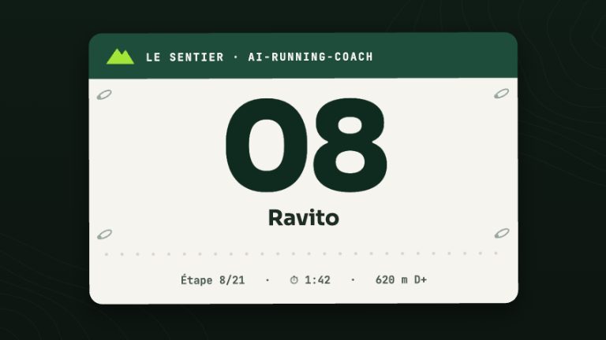

# Skill : `/log` — saisie libre

> **Description** : Journal en une phrase — ravitaillement, hydratation, douleur, RPE, retour de chaussant — converti en blocs `arc` structurés, sans jamais inventer une valeur nutritionnelle.

<!-- arc-video:ravito -->
<div class="arc-video-card" markdown>

[](../video/ravito/index.html)

<div markdown>

<span class="arc-video__meta">En vidéo · Étape 08 · 1 min 43</span>

**[Ravito](../video/ravito/index.html)** — Une phrase libre devient des données : le modèle extrait, le script calcule, et ne devine jamais un produit.

[Regarder](../video/ravito/index.html) · [English](../video/ravito/index.html?lang=en) · [Toutes les vidéos](../videos.md)

</div>

</div>
<!-- /arc-video -->


## Quand l'utiliser

- L'athlète tape `/log` ou décrit en une phrase ce qu'il a mangé/bu pendant une séance, une douleur ressentie, ou son ressenti d'effort (RPE)
- Exemple : « 2 gels + 500 ml au km 15, genou gauche 3/10, RPE 7 »

## Fonctionnalités

- Extraction d'entités par le modèle (produit, quantité, zone douloureuse, score, RPE, position dans la séance)
- **Arithmétique, correspondance catalogue et fusion déterministes**, jamais faites par le modèle : `scripts/arc_log.py` fait la somme des glucides (produit apparié dans les deux sens du pluriel français), convertit un liquide (ml/cl/dl/l, « N x M ml », fractions « ½ »/« et demi ») via `resources/nutrition/catalogue-produits-*.md`, et fusionne avec le bloc `arc` déjà présent sans jamais recompter deux fois la même déclaration (détection de doublon par ligne de provenance)
- Produit **inconnu** ou **ambigu** (plusieurs candidats dans le catalogue), liquide sans unité reconnue, douleur ou RPE hors de 0-10 → l'agent demande, ne devine jamais une valeur
- Écriture au contrat, en fusionnant avec le fichier existant du jour (jamais d'écrasement) :
  - `carbs_g`, `fluid_intake_ml` → `activities/YYYY-MM-DD_<type>.md` (séance du jour, agent `nutritionist` si activé sinon `coach`)
  - `rpe` → même fichier (agent `coach`, charge d'entraînement)
  - `pain` (`{location, score}`) → `medical/YYYY-MM-DD_health.md` (agent `medical` si activé, sinon `coach`)
  - Une douleur ≥ `[injury_risk].pain_consult_threshold` (résolu depuis la configuration vivante, 7/10 par défaut) déclenche une recommandation de consultation immédiate
  - Une synchronisation Garmin ultérieure ne bloque ni ne duplique un fichier créé par `/log` : `garmin-sync-efficiency` fusionne ses champs dans le même fichier plutôt que d'en créer un second
- **Cycle menstruel (opt-in, #166)** : seulement si `[health].cycle_tracking` n'est pas `off` (défaut), une phase ou un jour de cycle déclaré (« phase lutéale », « jour 21 ») est normalisé par le script et écrit en `cycle_phase`/`cycle_day`/`cycle_source: "manual"` dans `medical/YYYY-MM-DD_health.md` ; à `off`, la saisie est ignorée et rien n'est écrit. Voir [Cycle menstruel](../cycle-menstruel.md).
- **Poussée vers Garmin (opt-in, #167)** : seulement si `[nutrition].garmin_sync = "ask"`, la confirmation est suivie d'une **proposition** de pousser l'apport vers Garmin Connect (jamais automatique, jamais en headless, « oui » explicite par poussée). À `off` (défaut) : aucune mention. Voir [Apports vers Garmin](../nutrition-garmin.md).
- **Retour de chaussant (#299)** : « Kipride : ampoule au talon gauche, avant-pied serré, confort 6 » → `shoe_feedback` (`comfort` 0-10, `issues[]` à `kind` d'une liste fermée, `zone`/`side` facultatifs, `notes`) dans l'activité, **avec son `gear_id`**. Séance sans paire, paire inconnue ou ambiguë, ou paire différente de celle déjà écrite → l'agent **demande quelle paire** avant d'écrire ; terme, zone ou confort inconnu → il demande aussi. Le retour ne remplace jamais `pain` : « ampoule + douleur 7/10 » écrit les deux, la consultation reste recommandée au seuil, et l'ampoule n'est jamais présentée comme la cause de la douleur. Voir [Choisir ses chaussures](../shoes.md).
- Une position déclarée (« au km 15 ») reste du texte libre sous le bloc — aucune clé du contrat ne la porte
- Confirmation en **une ligne**, nommant le produit apparié : ce qui a été écrit, où

## Script

`scripts/arc_log.py` — **stdlib uniquement**, aucune dépendance externe. Interface JSON en entrée (entités extraites par le modèle), JSON en sortie (macros calculées, correspondances, avertissements).

## Utilisation

```bash
echo '{"catalogue_paths": ["resources/nutrition/catalogue-produits-famille.md"],
       "nutrition_items": [{"product": "gel", "qty": "2"}],
       "fluid_entries": ["500 ml"],
       "pain": [{"location": "genou gauche", "score": "3"}],
       "rpe": "7"}' | python3 scripts/arc_log.py
```

Avec un retour de chaussant, ajoutez `"shoe_feedback": {"pair": "Kipride", "comfort": "6", "issues": [{"term": "ampoule", "zone": "talon", "side": "gauche"}]}` et `"declared_gear"` (paires du profil) ; la sortie porte `shoe_feedback.ready` / `unknown` / `needs_gear` et `activity_merge.shoe_feedback`.

## Fichier source

`skills/log/SKILL.md`
