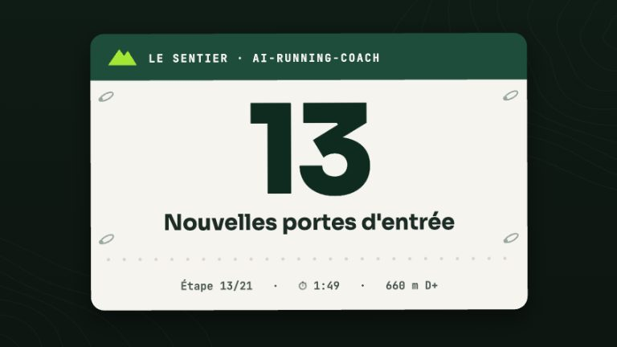

# Le bot Telegram

ntfy prévient, mais à sens unique. Le bot Telegram ajoute le **retour en un geste** : sous le
résumé de la synchronisation quotidienne, vous touchez « Séance faite », un RPE ou « Douleur », et
le coach l'a dans vos fichiers — **sans aucun modèle, donc sans clé d'API ni coût**. Une
conversation libre avec le coach est possible en option : facturée à la clé d'API (niveau 2, voir
[le coach dans la poche](mobile.md#ce-qui-nest-pas-possible-et-pourquoi)), ou **sur votre abonnement
claude.ai** avec un second bot (niveau 3, expérimental).

<!-- arc-video:sources-retours -->
<div class="arc-video-card" markdown>

[](video/sources-retours/index.html)

<div markdown>

<span class="arc-video__meta">En vidéo · Étape 13 · 1 min 49</span>

**[Nouvelles portes d'entrée](video/sources-retours/index.html)** — Strava comme troisième source de données, retours en un geste par Telegram sans aucun modèle, et deux options à activer soi-même : le contexte du cycle et les apports poussés vers Garmin.

[Regarder](video/sources-retours/index.html) · [English](video/sources-retours/index.html?lang=en) · [Toutes les vidéos](videos.md)

</div>

</div>
<!-- /arc-video -->

!!! note "Un canal pour l'athlète, pas un outil des agents"
    Le bot lit vos appuis et écrit dans votre workspace. Aucun agent ne s'en sert pour agir, et il
    n'appelle jamais Garmin : aucune écriture Garmin ne passe par ce canal sans l'approbation
    explicite du chat (niveau 2), et jamais en headless.

## Les trois niveaux

| Niveau | Ce que vous obtenez | Modèle / clé d'API | Clé de configuration |
|---|---|---|---|
| **1 — retours en un geste** | Boutons sous le résumé du daily-sync, commandes `/rpe`, `/douleur`, `/statut` | **Aucun** | `[telegram].enabled = true` |
| **2 — conversation libre** | Vos messages libres vont au coach du [chat du tableau de bord](dashboard/chat.md) ; les confirmations d'écriture deviennent des boutons « Appliquer / Refuser » | **Clé d'API facturée** (plafond quotidien du chat) | `[telegram].chat_bridge = true` **et** `[chat].enabled = true` |
| **3 — conversation sur abonnement** (expérimental) | Une session Claude Code permanente reçoit vos messages par le plugin officiel *Channels* ; agents, skills et MCP à disposition | **Abonnement claude.ai**, aucune clé d'API — **second bot obligatoire** | `scripts/coach-telegram-chat.sh install` ; section `[telegram_chat]` |

Le niveau 2 ne contient **aucun second moteur de chat** : le texte est relayé au service
`arc_chat` déjà en place, avec sa politique (`config/chat-policy.toml`), ses approbations et son
plafond de dépense. Le niveau 3 est un mécanisme **distinct** (une session Claude Code, pas `arc_chat`) : voir plus bas. Si le chat est désactivé, ou si `chat_bridge` est à `false`, le bot répond par
une courte explication.

## Ce que font les boutons

Après chaque synchronisation (`scripts/daily-sync.sh`), le résumé part sur Telegram (en plus de
ntfy s'il est configuré) avec :

| Bouton | Effet dans le workspace |
|---|---|
| ✅ Faite · ❌ Pas faite · ⏭ Décalée | `status` de la séance prévue du jour (`done` / `missed` / `moved`) dans le fichier semaine. « Décalée » ne modifie **pas** le calendrier Garmin : demandez au coach de la replacer. |
| 1 … 10 | `rpe` de l'activité du jour (`activities/AAAA-MM-JJ_*.md`). Un nouvel appui remplace la valeur. |
| 🩹 Douleur | Parcours guidé : zone, puis score /10, puis une note facultative (un texte en réponse). Écrit `pain` dans `medical/AAAA-MM-JJ_health.md` (créé s'il manque). |

Mêmes retours en texte : `/rpe 7`, `/douleur genou gauche 3 apparue au km 12`, `/statut décalée`.

Les écritures utilisent **la même logique que `/log`** (`scripts/arc_log.py` : validation 0-10,
détection de doublon, fusion, seuil de consultation), valident le contrat `arc`, ajoutent une ligne
de provenance sous le bloc, puis réindexent le tableau de bord. Elles sont **idempotentes** : le
même appui deux fois n'écrit qu'une fois, et le bot dit « déjà noté ». Un score de douleur au seuil
`[injury_risk].pain_consult_threshold` (7/10 par défaut) déclenche la même recommandation de
consultation que `/log` ; rien n'est modifié dans votre plan depuis ce canal.
Une douleur légère saisie ici peut ensuite valoir une proposition de routine douce de prévention à la
prochaine interaction avec le coach (#192, [Prévention ciblée](strength.md#prevention-ciblee)) — jamais un envoi
automatique.

Si aucune séance n'est synchronisée pour le jour visé, le bot le dit et n'écrit rien — il n'invente
jamais une activité.

## Installation

### 1. Créer le bot (BotFather)

1. Dans Telegram, ouvrez la conversation avec **@BotFather** et envoyez `/newbot`.
2. Donnez un nom puis un identifiant (finissant par `bot`). BotFather répond avec le **jeton** du bot
   (`<nombre>:<chaîne>`).
3. **Le jeton donne le contrôle du bot** à quiconque le possède : ne le collez dans aucun chat,
   dépôt, TOML ou capture. En cas de fuite, régénérez-le avec BotFather (commande `/token`).
4. Ouvrez la conversation avec **votre** bot et appuyez sur *Démarrer* : un bot ne peut pas écrire à
   quelqu'un qui ne l'a pas contacté d'abord.

### 2. Installer le service

```bash
./install.sh --telegram
```

Cela active `[telegram].enabled`, crée `~/.config/ai-running-coach/telegram.env` (mode 600, avec une
ligne d'exemple commentée) et installe le service (`scripts/coach-telegram.sh` : launchd sous macOS,
`systemd --user` sous Linux, `screen`/`tmux` sinon). **Le jeton n'est jamais une option de ligne de
commande** (il finirait dans l'historique du shell) : ouvrez le fichier et ajoutez la ligne

```
TELEGRAM_BOT_TOKEN=<le jeton de BotFather>
```

Un second lancement de `./install.sh` n'écrase rien : ni votre configuration, ni votre jeton.

### 3. Autoriser votre chat (liste blanche)

Le bot **ignore en silence** tout chat absent de `[telegram].allowed_chat_ids` (liste vide = tout est
refusé). Pour trouver votre identifiant sans jamais exposer le jeton :

1. Envoyez `/start` à votre bot.
2. Arrêtez le service s'il tourne (`scripts/coach-telegram.sh stop`) : Telegram refuse deux
   interrogations simultanées.
3. Lancez `python3 scripts/arc_telegram.py whoami` : il lit le jeton dans son fichier et affiche
   seulement `chat id : <nombre>` — jamais le jeton, jamais le contenu des messages.
4. Autorisez-le : `./install.sh --telegram --telegram-chat-id <nombre>` (ajoute à la liste, sans
   rien retirer) ou éditez `config/workspace.user.toml` :

```toml
[telegram]
allowed_chat_ids = ["123456789"]
```

Utilisez une conversation **privée** avec le bot. Un groupe n'est accepté que s'il figure dans la
liste **et** que l'auteur du message y figure aussi.

Puis `scripts/coach-telegram.sh start`, et vérifiez : `python3 scripts/coach_doctor.py --check telegram`.

### 4. (Option) La conversation libre

```bash
./install.sh --llm anthropic --chat            # ou openrouter / openai : voir le chat du tableau de bord
```

puis dans `config/workspace.user.toml` :

```toml
[telegram]
chat_bridge = true
```

Le pont exige `[chat].enabled = true`, `[chat].auth = "local"` (le bot parle au service sur la boucle
locale) et une clé d'API dans `llm.env`. Chaque message libre est un tour de chat facturé (voir le plafond
`[chat].daily_budget_eur`). Quand le coach propose une modification (par exemple pousser une séance
au calendrier Garmin), le bot envoie la proposition avec **✅ Appliquer / ✖ Refuser** : rien n'est
écrit chez Garmin sans votre appui. `/nouveau` ouvre une conversation neuve.

## Niveau 3 — conversation sur abonnement (Claude Code Channels, expérimental)

!!! warning "Expérimental"
    *Channels* est une **research preview** de Claude Code : son interface et ses garanties peuvent
    changer, et ce mode n'a pas été éprouvé de bout en bout par les tests automatiques du projet
    (ils vérifient le script, les permissions et le diagnostic, pas la session réelle). Le niveau 1
    reste le chemin sûr et gratuit.

### Ce qui change avec `chat_bridge` (niveau 2)

| | Niveau 2 — `chat_bridge` | Niveau 3 — Channels |
|---|---|---|
| Qui répond | le service `arc_chat` du tableau de bord | une session **Claude Code** complète, dans le workspace |
| Facturation | **clé d'API**, plafond `[chat].daily_budget_eur` | **abonnement claude.ai**, aucune clé d'API |
| Approbations | boutons « Appliquer / Refuser » dans Telegram | politique de permissions de la session (`templates/settings.telegram.json`) |
| Bot Telegram | celui de `[telegram]` | **un second bot, distinct** |
| Outils | ceux de `config/chat-policy.toml` | agents, skills et serveurs MCP du workspace, dans les limites ci-dessous |

Le bot `arc_telegram` (niveaux 1 et 2) ne peut pas utiliser un abonnement : il appelle lui-même un
modèle. Ici, c'est Claude Code, lancé par vous sur votre machine, qui reçoit les messages par le
plugin Telegram officiel (`telegram@claude-plugins-official`) : l'abonnement reste
celui d'une session Claude Code ordinaire.

### Prérequis

- Claude Code **connecté par `/login` à un compte claude.ai** (`ANTHROPIC_API_KEY` ne doit pas être défini : le script refuse de démarrer sinon) ;
- [Bun](https://bun.sh) (le plugin en a besoin) et **tmux** ;
- **un second bot** créé avec BotFather (voir ci-dessous) ;
- une machine qui reste allumée (Linux avec `systemd --user`, ou macOS avec launchd — empêchez la mise en veille).

### Un bot distinct (obligatoire)

Créez un **deuxième** bot avec @BotFather (`/newbot`). Le premier reste celui de `[telegram]`
(niveaux 1 et 2). Les deux processus interrogent Telegram en *long polling* (`getUpdates`) : sur le
**même** bot, chacun coupe l'autre et vous obtenez l'erreur `409 Conflict`. Le jeton du plugin
(`~/.claude/channels/telegram/.env`, `TELEGRAM_BOT_TOKEN`) doit donc différer de celui de
`[telegram].token_file`. `scripts/coach-telegram-chat.sh` **refuse de démarrer** s'ils sont identiques
(le message ne montre aucun jeton) et `coach-doctor` le détecte (`--check telegram_chat`).

### Mise en route

```bash
# 1. Dans Claude Code : plugin et jeton du SECOND bot
/plugin install telegram@claude-plugins-official
/telegram:configure <jeton du second bot>

# 2. Appairage (une fois, au premier plan)
scripts/coach-telegram-chat.sh run --pairing
#    écrivez au bot : il répond par un code ; dans la session :
#    /telegram:access pair <code>
#    /telegram:access policy allowlist      # puis Ctrl+C deux fois

# 3. Service permanent (tmux sur une socket dédiée, systemd --user ou launchd)
scripts/coach-telegram-chat.sh install
scripts/coach-telegram-chat.sh status
```

`scripts/coach-telegram-chat.sh --dry-run install` affiche ce qui serait fait sans rien écrire.
Sans `allowlist`, la session ne démarre pas : elle lit des données de santé et peut préparer des
écritures vers votre montre. `start`, `stop`, `restart`, `logs` et `uninstall` complètent la commande ;
`tmux -L coach-telegram-chat attach -t coach-telegram-chat` ouvre la session (détacher : Ctrl-b d).
La session redémarre chaque nuit (`[telegram_chat].daily_restart`, contexte neuf).

### Ce que la session peut faire — et ne fait pas

Le mode est piloté par des messages distants : on suppose que **quiconque contrôle le bot** (compte
autorisé compromis, jeton du bot volé) peut dicter ce que la session essaie de faire. Le modèle de
sécurité repose donc sur la politique du chat (`config/chat-policy.toml`), appliquée par un hook
`PreToolUse` — et non sur la seule bonne volonté du modèle. `install` fusionne
`templates/settings.telegram.json` (permissions **et** hook) dans `.claude/settings.local.json` du
workspace, sans rien retirer de vos règles :

- **Le hook** (`scripts/arc_telegram_hook.py`) ne fait que **durcir** : il ne répond jamais « allow » (ce qui lèverait une règle `ask` des réglages) ; quand la politique laisse passer, il se tait et les règles de `settings.local.json` décident — une commande shell sans règle `allow` demande donc l'approbation. Il soumet chaque commande shell, chemin lu ou écrit et URL à
  `arc_chat_policy.Policy.decide`, comme le chat du tableau de bord : un script n'est autorisé que sous
  son préfixe **et** avec les options déclarées (`--python`, `--workspace`, `--tokens-dir`,
  `--garmin-host`… sont refusées) ; un chemin hors du workspace ou secret est refusé ; une écriture hors de
  `activities/`, `medical/`, `nutrition/`, `planning/`, `rapports/`, `gear/` est refusée ; un domaine web
  hors liste demande l'approbation. Le hook traduit les appels d'outils **exactement comme le chat du tableau de bord** (`arc_chat_claude.canonical_tool` : la regex d'un `Grep`, le filtre d'un `Glob`, les chemins d'un patch lui parviennent), un outil inconnu est refusé, et la base dérivée `.arc/` n'est jamais lisible. Toute erreur du hook vaut refus.
- **`allow`** (sans hook, en filet) : lectures bornées à ces dossiers de données et au moteur
  (`skills/`, `agents/`, `docs/`), outils de lecture `get_*` de Garmin, écritures sous les dossiers de
  données seulement, météo (`wttr.in`). **Aucune règle shell à joker** (`Bash(script:*)`), aucun `Read`,
  `WebFetch` ou `Write` sans périmètre.
- **`ask`** : toute écriture Garmin, COROS, Strava ou intervals.icu (envoi d'une séance, `icu_update_*`…) —
  jamais autorisée d'office. Le skill `telegram-chat` exige en plus un « OK » explicite dans un message
  Telegram suivant ; `--write`, `--mark-retired` et `--apply` des scripts demandent l'approbation.
- **`deny`** : suppressions et désinscriptions ; fichiers secrets (`.env`, `*.token`, `~/.garminconnect`,
  `~/.claude/.credentials.json`, `~/.ssh`, le `.env` du plugin, `~/.config/ai-running-coach`) ; options de
  script détournantes ; **modification des réglages et du moteur** (`.claude/`, `.mcp.json`, `scripts/`,
  `config/`, `skills/`, `agents/`…) pour que la session ne puisse ni élargir ses droits ni changer le hook.

`tests/lint/test_telegram_chat_lint.py` verrouille ces propriétés. Limites connues : la syntaxe
des motifs `~/` et `//` de Claude Code et le comportement d'un hook « allow » face aux règles `ask` n'ont pas
été éprouvés sur une session réelle ; un compte autorisé reste un utilisateur de confiance (il lit vos
données de santé).

Le mode de permission par défaut est `default` (et non `acceptEdits`, qui validerait toute écriture du
workspace). Si la session a besoin d'une approbation que le plugin ne relaie pas, elle attend à son
terminal : `tmux attach`. Ce comportement de *Channels* n'a pas été vérifié par le projet.

### Confidentialité

Comme pour tout bot Telegram, vos messages ne sont **pas chiffrés de bout en bout** : Telegram peut les
lire (voir plus bas). S'y ajoute que le texte de la conversation est traité par Claude Code et donc par
Anthropic, selon les conditions de votre abonnement. Seuls les comptes de l'*allowlist* atteignent la
session ; elle ne modifie jamais l'accès à la demande d'un message.

## Confidentialité, sécurité et coûts

- **Les échanges avec le bot ne sont PAS chiffrés de bout en bout : Telegram peut les lire.** Selon
  la [FAQ de Telegram](https://telegram.org/faq), seules les « discussions secrètes » sont chiffrées de
  bout en bout ; les discussions ordinaires (*cloud chats*) sont chiffrées entre l'appli et les serveurs
  de Telegram, qui les stockent. Une conversation avec un bot en est une : la
  [Bot API](https://core.telegram.org/bots/api) remet au service le texte de vos messages, en clair,
  depuis les serveurs de Telegram. Le résumé du daily-sync (charge, sommeil, état de forme), vos RPE
  et vos douleurs transitent donc par Telegram.
  N'activez `send_summary` que si cela vous convient (`send_summary = false` coupe l'envoi du résumé
  tout en gardant `/rpe`, `/douleur`, `/statut`).
- **Aucune adresse publique à exposer** : le service interroge l'API Telegram (*long polling*,
  `getUpdates`) depuis votre machine. Aucun webhook, donc aucun port ouvert.
- **Liste blanche stricte** ; un chat inconnu ne reçoit aucune réponse (son identifiant apparaît
  seulement dans le journal du service, ce qui permet d'ajouter le vôtre).
- **Le jeton** vit dans un fichier hors dépôt en mode 600, n'est jamais écrit dans le TOML, dans les
  journaux ni dans l'unité de service, et `coach-doctor` ne l'affiche jamais.
- **Coûts** : niveau 1 gratuit (l'API des bots Telegram l'est). Niveau 2 : clé d'API du fournisseur
  choisi pour le chat, plafonnée par `[chat].daily_budget_eur` — c'est la contrainte décrite dans
  [le coach dans la poche](mobile.md) : le bot `arc_telegram` (niveaux 1 et 2) ne peut pas utiliser un
  abonnement. Niveau 3 : aucun coût d'API, il consomme les limites de votre abonnement claude.ai.
- Limites de l'API respectées : au plus un message par seconde par chat, 429 (`retry_after`) honoré,
  messages longs découpés sous 4096 caractères, données de rappel (`callback_data`) de 64 octets
  au plus.

## Dépannage

| Symptôme | Piste |
|---|---|
| Rien ne part après la synchro | `python3 scripts/coach_doctor.py --check telegram` ; `[telegram].enabled`, `send_summary`, `allowed_chat_ids` ; `logs/sync-*.log`. |
| Les boutons ne font rien | Le service tourne-t-il ? `scripts/coach-telegram.sh status` et `logs` (journal : `logs/telegram.log`). |
| `conflit (409)` dans le journal | Un autre `getUpdates` (ou un webhook posé auparavant) utilise le même bot : arrêtez l'autre consommateur. |
| `jeton refusé (401)` | Jeton erroné ou régénéré : corrigez `telegram.env`, puis `scripts/coach-telegram.sh restart`. |
| « Aucune séance synchronisée » | Le RPE se rattache à une activité déjà dans `activities/` : relancez après la synchro. |
| `409 Conflict` dans la session du niveau 3 (ou dans le journal du bot) | Les deux modes partagent le même bot : voir « Un bot distinct » ci-dessous. |
| « Conversation libre indisponible » | `chat_bridge`, `[chat].enabled`, `auth = "local"`, service du chat joignable (`scripts/coach-chat.sh status`). |

## Sources vérifiées (Bot API)

Comportements confirmés dans la documentation officielle de Telegram : [Bot API](https://core.telegram.org/bots/api)
(`getUpdates` : `offset`, `timeout`, *long polling* incompatible avec un webhook actif, mises à jour conservées 24 h au plus ;
`sendMessage` : texte de 1 à 4096 caractères ; `InlineKeyboardButton.callback_data` : 1 à 64 octets ;
`answerCallbackQuery`), [FAQ des bots](https://core.telegram.org/bots/faq) (une conversation : pas plus d'un message par
seconde, erreurs 429) et [fonctionnalités](https://core.telegram.org/bots/features#botfather) (`/newbot`, jeton,
`/token`, un bot n'écrit pas le premier). Le service n'a **pas** été exécuté contre l'API réelle dans le cadre du
développement : les tests utilisent un faux serveur local (`tests/lib/telegram_stub.py`).
