# Le Sentier — les vidéos

<div class="arc-page-banner" markdown>
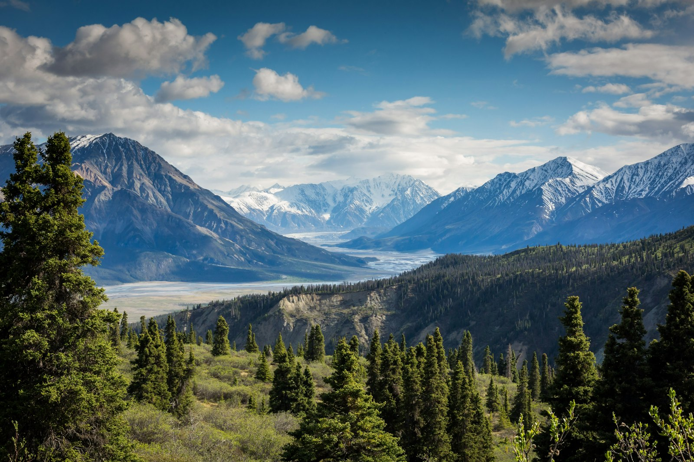
</div>

**Le Sentier** est une série de courtes vidéos, une par fonctionnalité, à mi-chemin
entre la démonstration et la documentation. Chaque vidéo est une **étape** : un dossard au
départ, des **ravitos** (les chapitres, cliquables sur le profil altimétrique du lecteur) et
une arche d'arrivée qui renvoie vers la page de documentation correspondante.

On y suit **Camille**, une athlète fictive qui prépare le *Trail des Crêtes* (42 km,
2 100 m D+). Toutes les données montrées sont inventées.

!!! tip "Dans le lecteur"
    Narration en **français** ou en **anglais** (sélecteur de langue), **sous-titres**
    (bouton ou touche `c`), espace pour lecture/pause, flèches pour ±5 s. Le tableau de bord
    n'existe qu'en français : les versions anglaises gardent ses captures, légendées en anglais.

<!-- arc-videos:start -->
<div class="arc-videos" markdown>

<div class="arc-video arc-video--featured" markdown>

[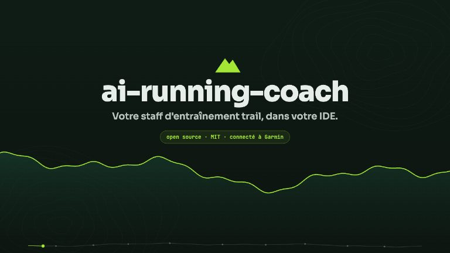](video/index.html)

<span class="arc-video__meta">Bande-annonce · 1 min 35</span>

### [La bande-annonce](video/index.html)

Le projet en un coup d'œil : le staff, le bilan matinal, les garde-fous, le jour de course, vos données.

[Regarder](video/index.html) · [English (1 min 34)](video/index.html?lang=en)

</div>

<div class="arc-video" markdown>

[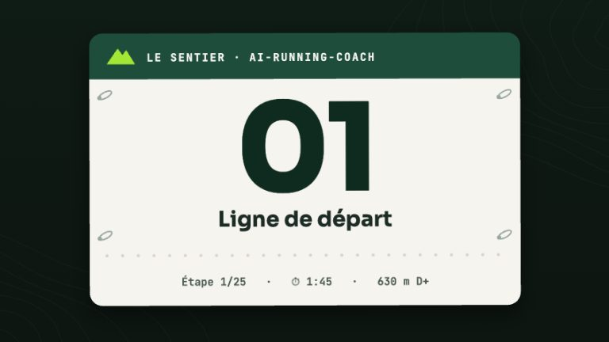](video/ligne-de-depart/index.html)

<span class="arc-video__meta">Étape 01 · 1 min 45</span>

### [Ligne de départ](video/ligne-de-depart/index.html)

Du git clone au premier /today : installation, authentification Garmin, /coach-setup et /coach-doctor en moins de deux minutes.

[Regarder](video/ligne-de-depart/index.html) · [English (1 min 43)](video/ligne-de-depart/index.html?lang=en) · [La documentation](quickstart.md)

</div>

<div class="arc-video" markdown>

[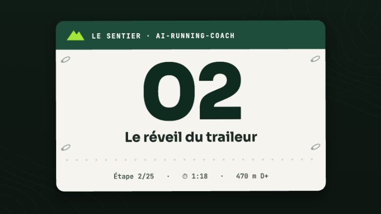](video/bilan-matinal/index.html)

<span class="arc-video__meta">Étape 02 · 1 min 19</span>

### [Le réveil du traileur](video/bilan-matinal/index.html)

HRV, FC de repos et readiness lues ensemble chaque matin : le verdict, sa raison, et comment régler le bilan.

[Regarder](video/bilan-matinal/index.html) · [English (1 min 18)](video/bilan-matinal/index.html?lang=en) · [La documentation](skills/today.md)

</div>

<div class="arc-video" markdown>

[](video/garde-fous/index.html)

<span class="arc-video__meta">Étape 03 · 1 min 46</span>

### [Le plan qui sait dire non](video/garde-fous/index.html)

Sept garde-fous calculés relisent la semaine avant son écriture et son envoi au calendrier Garmin : un second avis déterministe et testé.

[Regarder](video/garde-fous/index.html) · [English (1 min 42)](video/garde-fous/index.html?lang=en) · [La documentation](guardrails.md)

</div>

<div class="arc-video" markdown>

[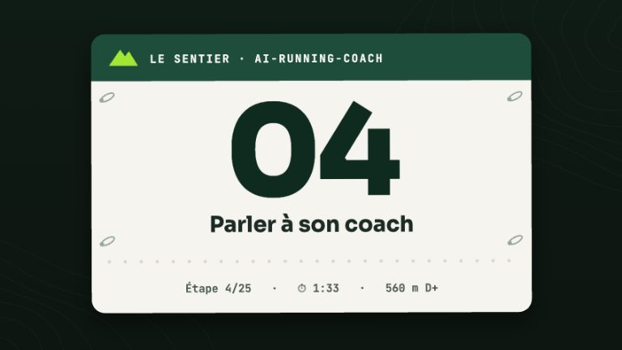](video/chat-coach/index.html)

<span class="arc-video__meta">Étape 04 · 1 min 33</span>

### [Parler à son coach](video/chat-coach/index.html)

Le chat du tableau de bord : trace des outils, carte d'approbation, politique de permissions, budget et fournisseurs.

[Regarder](video/chat-coach/index.html) · [English (1 min 37)](video/chat-coach/index.html?lang=en) · [La documentation](dashboard/chat.md)

</div>

<div class="arc-video" markdown>

[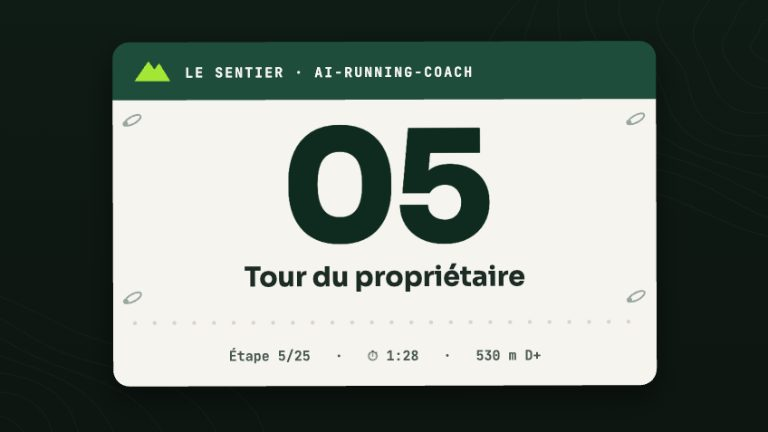](video/tableau-de-bord/index.html)

<span class="arc-video__meta">Étape 05 · 1 min 29</span>

### [Tour du propriétaire](video/tableau-de-bord/index.html)

Visite guidée du tableau de bord local, en lecture seule : une question par vue (ancien design, avant la 1.4).

[Regarder](video/tableau-de-bord/index.html) · [English (1 min 26)](video/tableau-de-bord/index.html?lang=en) · [La documentation](dashboard/views.md)

</div>

<div class="arc-video" markdown>

[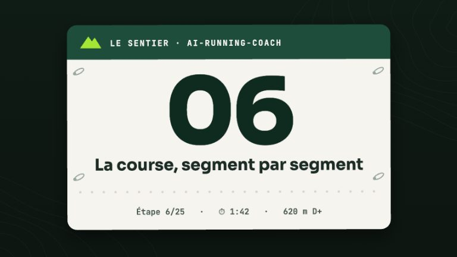](video/jour-de-course/index.html)

<span class="arc-video__meta">Étape 06 · 1 min 43</span>

### [La course, segment par segment](video/jour-de-course/index.html)

Du GPX au plan de course : allures par segment, énergie, matériel obligatoire, montre, puis débrief plan contre réalisé.

[Regarder](video/jour-de-course/index.html) · [English (1 min 41)](video/jour-de-course/index.html?lang=en) · [La documentation](agents/course-strategist.md)

</div>

<div class="arc-video" markdown>

[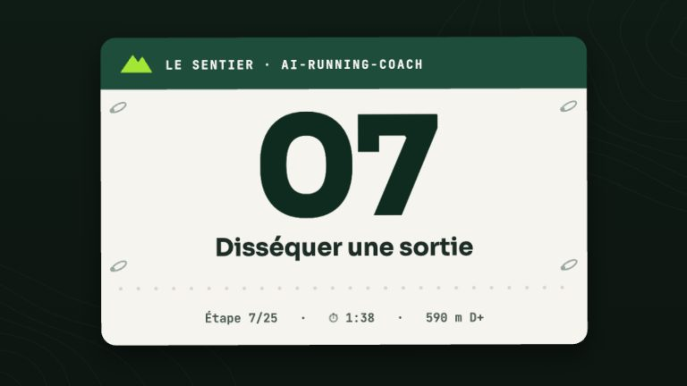](video/analyse-seance/index.html)

<span class="arc-video__meta">Étape 07 · 1 min 39</span>

### [Disséquer une sortie](video/analyse-seance/index.html)

Une sortie trail passée au scalpel : FIT, zones, allure ajustée, dérive, montées, durabilité, HRR, énergie, comparaison.

[Regarder](video/analyse-seance/index.html) · [English (1 min 40)](video/analyse-seance/index.html?lang=en) · [La documentation](skills/session-parts-analyzer.md)

</div>

<div class="arc-video" markdown>

[](video/ravito/index.html)

<span class="arc-video__meta">Étape 08 · 1 min 43</span>

### [Ravito](video/ravito/index.html)

Une phrase libre devient des données : le modèle extrait, le script calcule, et ne devine jamais un produit.

[Regarder](video/ravito/index.html) · [English (1 min 44)](video/ravito/index.html?lang=en) · [La documentation](skills/log.md)

</div>

<div class="arc-video" markdown>

[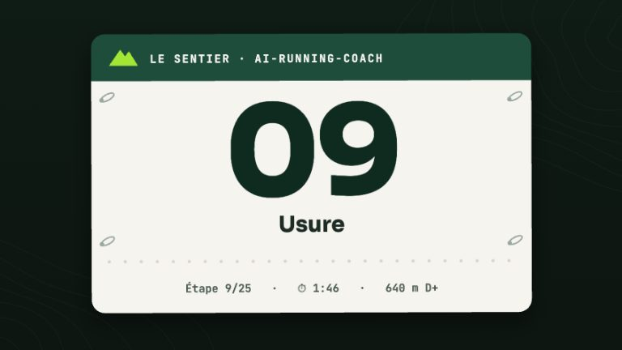](video/materiel/index.html)

<span class="arc-video__meta">Étape 09 · 1 min 47</span>

### [Usure](video/materiel/index.html)

Du kilométrage à l'inspection photo : alerte de seuil, verdict en quatre couleurs, indices de foulée (jamais un diagnostic), foulée mesurée, kits et bilan de carrière.

[Regarder](video/materiel/index.html) · [English (1 min 42)](video/materiel/index.html?lang=en) · [La documentation](skills/gear-inspection.md)

</div>

<div class="arc-video" markdown>

[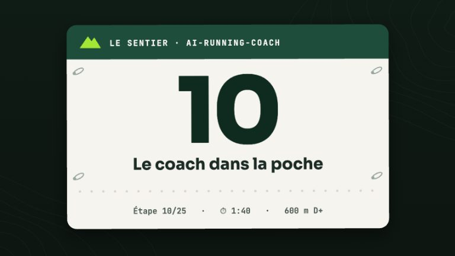](video/coach-poche/index.html)

<span class="arc-video__meta">Étape 10 · 1 min 40</span>

### [Le coach dans la poche](video/coach-poche/index.html)

La machine coach, la synchronisation automatique (horaires ou veille), la notification push, Remote Control et les commandes courtes, le tableau de bord mobile, et ce qui n'est pas possible.

[Regarder](video/coach-poche/index.html) · [English (1 min 37)](video/coach-poche/index.html?lang=en) · [La documentation](mobile.md)

</div>

<div class="arc-video" markdown>

[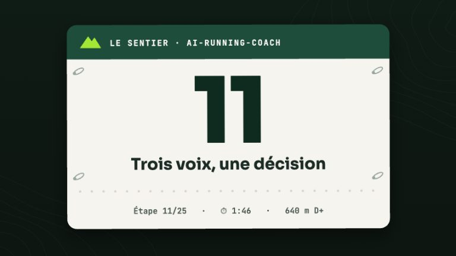](video/styles-coaching/index.html)

<span class="arc-video__meta">Étape 11 · 1 min 46</span>

### [Trois voix, une décision](video/styles-coaching/index.html)

La même décision dite par trois styles de coaching : le ton, la fermeté et la longueur se règlent, jamais le verdict.

[Regarder](video/styles-coaching/index.html) · [English (1 min 43)](video/styles-coaching/index.html?lang=en) · [La documentation](configuration.md)

</div>

<div class="arc-video" markdown>

[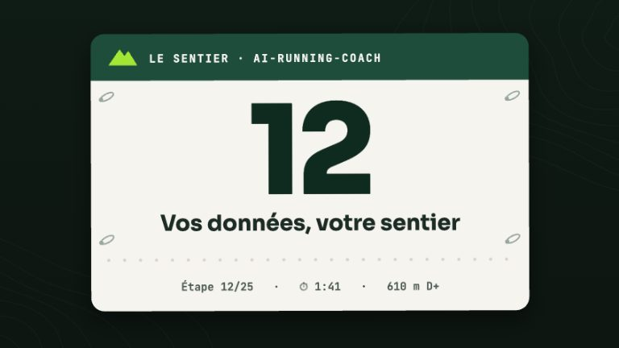](video/donnees/index.html)

<span class="arc-video__meta">Étape 12 · 1 min 42</span>

### [Vos données, votre sentier](video/donnees/index.html)

Vos données restent des fichiers Markdown chez vous : un bloc validé, un index jetable, un tableau de bord local, et ce qui quitte la machine.

[Regarder](video/donnees/index.html) · [English (1 min 43)](video/donnees/index.html?lang=en) · [La documentation](workspace.md)

</div>

<div class="arc-video" markdown>

[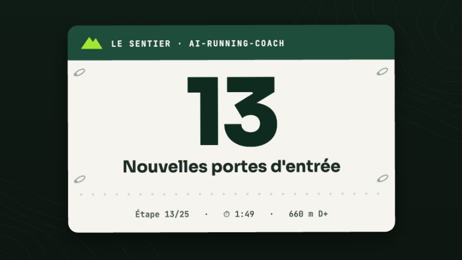](video/sources-retours/index.html)

<span class="arc-video__meta">Étape 13 · 1 min 49</span>

### [Nouvelles portes d'entrée](video/sources-retours/index.html)

Strava comme troisième source de données, retours en un geste par Telegram sans aucun modèle, et deux options à activer soi-même : le contexte du cycle et les apports poussés vers Garmin.

[Regarder](video/sources-retours/index.html) · [English (1 min 53)](video/sources-retours/index.html?lang=en) · [La documentation](strava-setup.md)

</div>

<div class="arc-video" markdown>

[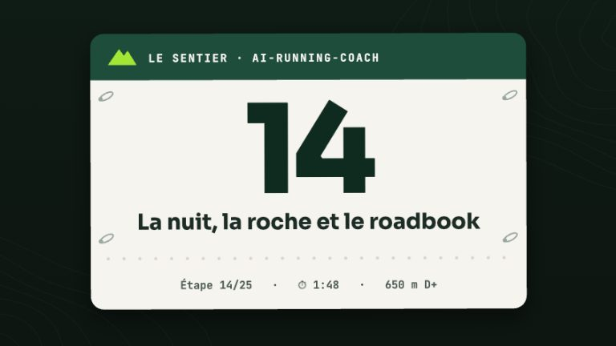](video/ultra/index.html)

<span class="arc-video__meta">Étape 14 · 1 min 49</span>

### [La nuit, la roche et le roadbook](video/ultra/index.html)

Préparer un ultra : la nuit calculée sur place (crépuscule, frontale, heure d'hiver), le dénivelé corrigé par un modèle de terrain, la technicité du sentier, puis le roadbook imprimable avec passages, barrières et matériel obligatoire.

[Regarder](video/ultra/index.html) · [English (1 min 54)](video/ultra/index.html?lang=en) · [La documentation](agents/course-strategist.md)

</div>

<div class="arc-video" markdown>

[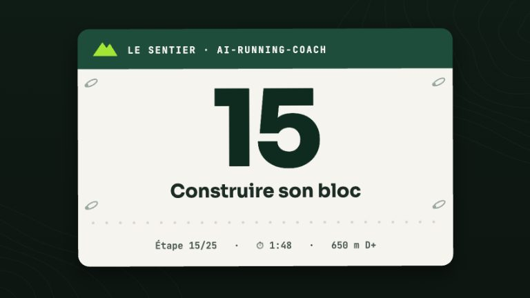](video/bloc/index.html)

<span class="arc-video__meta">Étape 15 · 1 min 48</span>

### [Construire son bloc](video/bloc/index.html)

Un bloc d'entraînement qui ne s'invente plus : gabarits de périodisation, squelette semaine par semaine relu par les garde-fous, frise du bloc sur le tableau de bord, renforcement par phase et prévention ciblée.

[Regarder](video/bloc/index.html) · [English (1 min 53)](video/bloc/index.html?lang=en) · [La documentation](plans.md)

</div>

<div class="arc-video" markdown>

[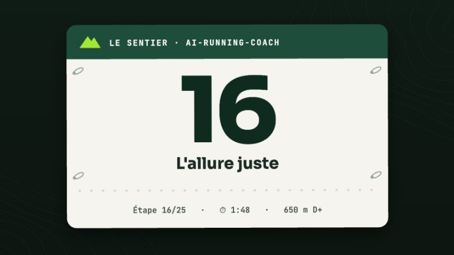](video/allure-juste/index.html)

<span class="arc-video__meta">Étape 16 · 1 min 48</span>

### [L'allure juste](video/allure-juste/index.html)

La pente, la durée et la chaleur ramenées à une allure juste : modèle de Kay et carte GAP, courbe allure-durée et vitesse critique, cibles de séance en pourcentage de cette vitesse, puis ralenties par la chaleur, FC inchangée.

[Regarder](video/allure-juste/index.html) · [English (1 min 57)](video/allure-juste/index.html?lang=en) · [La documentation](vitesse-critique.md)

</div>

<div class="arc-video" markdown>

[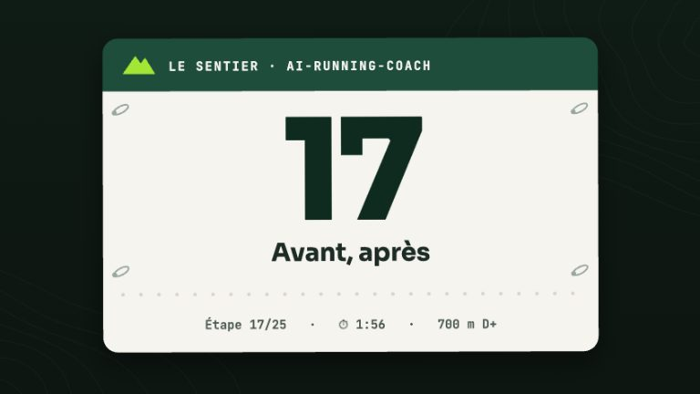](video/avant-apres/index.html)

<span class="arc-video__meta">Étape 17 · 1 min 57</span>

### [Avant, après](video/avant-apres/index.html)

Regarder devant et derrière, sans jamais inventer : forme projetée jusqu'au jour J et affûtage chiffré, pénalité d'altitude du plan de course, ce qui a suivi chaque décision du coach, puis le débrief qui propose des coefficients personnels.

[Regarder](video/avant-apres/index.html) · [English (2 min 11)](video/avant-apres/index.html?lang=en) · [La documentation](skills/why.md)

</div>

<div class="arc-video" markdown>

[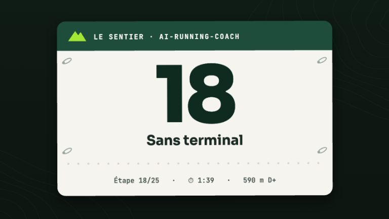](video/sans-terminal/index.html)

<span class="arc-video__meta">Étape 18 · 1 min 39</span>

### [Sans terminal](video/sans-terminal/index.html)

L'application macOS : un questionnaire à la place des lignes de commande, le chat intégré ou votre assistant habituel, des données qui restent chez vous, une synchronisation qui n'écrit jamais chez Garmin, et la pesée du matin lue en lecture seule.

[Regarder](video/sans-terminal/index.html) · [English (1 min 46)](video/sans-terminal/index.html?lang=en) · [La documentation](macos.md)

</div>

<div class="arc-video" markdown>

[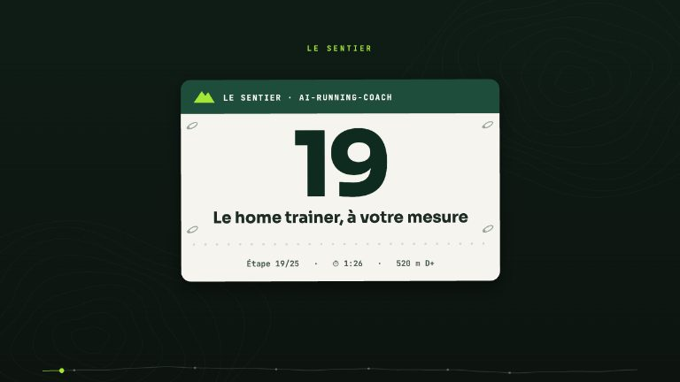](video/home-trainer/index.html)

<span class="arc-video__meta">Étape 19 · 1 min 27</span>

### [Le home trainer, à votre mesure](video/home-trainer/index.html)

Un parcours MyWhoosh qui tient dans la durée de la séance : puissance calibrée sur vos propres séances, catalogue des parcours, modèle de temps à ±10 %, nom du parcours sur la montre, calendrier MyWhoosh proposé, carte Home trainer du tableau de bord.

[Regarder](video/home-trainer/index.html) · [English (1 min 29)](video/home-trainer/index.html?lang=en) · [La documentation](skills/mywhoosh-route.md)

</div>

<div class="arc-video" markdown>

[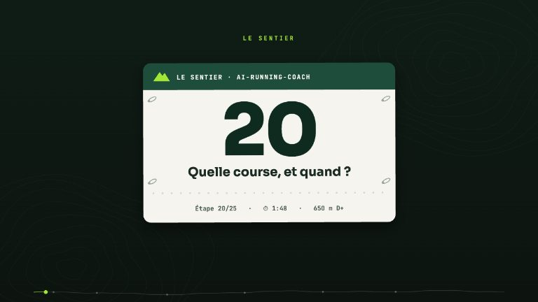](video/directeur-sportif/index.html)

<span class="arc-video__meta">Étape 20 · 1 min 49</span>

### [Quelle course, et quand ?](video/directeur-sportif/index.html)

L'agent directeur sportif : l'historique réel avant toute recherche, la faisabilité dite d'emblée, des courses sourcées sur le web et jamais inventées, un calendrier de saison calculé, l'avis médical qui l'emporte, et un objectif proposé sans jamais être écrit à votre place.

[Regarder](video/directeur-sportif/index.html) · [English (2 min 02)](video/directeur-sportif/index.html?lang=en) · [La documentation](agents/sports-director.md)

</div>

<div class="arc-video" markdown>

[](video/essai-gratuit/index.html)

<span class="arc-video__meta">Étape 21 · 1 min 49</span>

### [Zéro euro pour démarrer](video/essai-gratuit/index.html)

Quelle IA pour le coach ? Celle que vous payez déjà, sinon l'essai gratuit OpenRouter : une option à l'installation, une connexion en un clic sans clé à copier, puis ses limites dites honnêtement (quota, confidentialité) et le passage à « 10 $ une fois ».

[Regarder](video/essai-gratuit/index.html) · [English (1 min 55)](video/essai-gratuit/index.html?lang=en) · [La documentation](choisir-son-ia.md)

</div>

<div class="arc-video" markdown>

[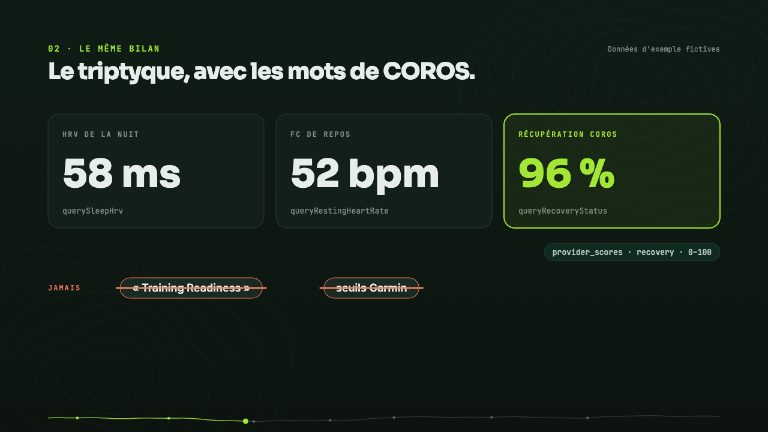](video/montre-coros/index.html)

<span class="arc-video__meta">Étape 22 · 1 min 45</span>

### [Une autre montre](video/montre-coros/index.html)

Camille passe à une montre COROS : le MCP officiel par un relais local et une seule connexion pour toutes les IA, le même bilan matinal avec une récupération COROS nommée sans conversion, les séances envoyées à la montre après un « oui », la fiche Pace Strategy à recopier le jour J, et les limites dites franchement.

[Regarder](video/montre-coros/index.html) · [English (1 min 49)](video/montre-coros/index.html?lang=en) · [La documentation](coros.md)

</div>

<div class="arc-video" markdown>

[](video/paire-suivante/index.html)

<span class="arc-video__meta">Étape 23 · 1 min 38</span>

### [La paire suivante](video/paire-suivante/index.html)

Une paire arrive en fin de vie : fiche de caractéristiques sourcée, retours de chaussant, profil d'usage, plages cibles par des règles à preuves et commande /shoes (continuité d'abord, veto médical, confort qui décide) — sans achat, sans prix, sans promesse de prévention.

[Regarder](video/paire-suivante/index.html) · [English (1 min 51)](video/paire-suivante/index.html?lang=en) · [La documentation](shoes.md)

</div>

<div class="arc-video" markdown>

[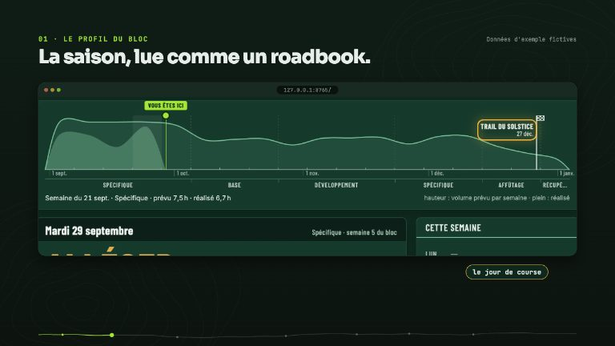](video/roadbook/index.html)

<span class="arc-video__meta">Étape 24 · 1 min 43</span>

### [Le nouveau roadbook](video/roadbook/index.html)

Le tableau de bord se lit comme le roadbook d'une course : profil du bloc, feuille de ravito du jour avec le verdict en grand, semaine sur une ligne par séance, navigation rail ou barre du bas, application installable, données qui restent chez vous.

[Regarder](video/roadbook/index.html) · [English (1 min 47)](video/roadbook/index.html?lang=en) · [La documentation](dashboard/index.md)

</div>

<div class="arc-video" markdown>

[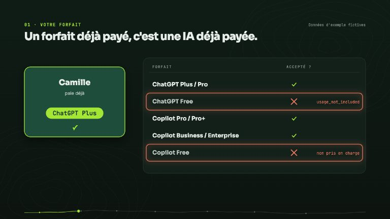](video/votre-ia/index.html)

<span class="arc-video__meta">Étape 25 · 1 min 43</span>

### [Votre IA, votre forfait](video/votre-ia/index.html)

Vous payez déjà ChatGPT ou GitHub Copilot ? Utilisez-le : une option à l'installation, une connexion unique, un coût « inclus dans votre forfait », le choix explicite de la synchronisation, puis le diagnostic « Tester la connexion » quand quelque chose ne répond plus.

[Regarder](video/votre-ia/index.html) · [English (1 min 52)](video/votre-ia/index.html?lang=en) · [La documentation](choisir-son-ia.md)

</div>

</div>
<!-- arc-videos:end -->

## Comment c'est fait

Aucun fichier vidéo n'est stocké : chaque image est **dessinée en JavaScript** sur un canvas,
à partir du seul temps écoulé. Une vidéo se lit, se met en pause et se parcourt comme une
vraie, mais pèse quelques dizaines de kilo-octets (plus sa piste de voix).

| Élément | Où | Rôle |
|---|---|---|
| Moteur | `docs/video/engine/` | Lecteur, profil altimétrique, dossard, arche d'arrivée, outils de dessin |
| Script | `docs/video/<étape>/script.json` | Découpage en scènes et texte dit, en français et en anglais |
| Scènes | `docs/video/<étape>/scenes.js` | Le dessin de chaque scène, calé sur les répliques |
| Voix | `audio/<langue>.m4a`, `timing.js`, `subs.<langue>.vtt` | Générés par `scripts/video_narration.py` |
| Captures | `docs/video/shots/` | Le vrai tableau de bord, servi sur l'espace de travail fictif de Camille |

La voix est une **synthèse vocale locale** ([Kokoro](https://github.com/thewh1teagle/kokoro-onnx),
hors ligne) : `ff_siwis` en français, `bm_george` en anglais. Les mots qu'elle prononce mal
se corrigent dans `docs/video/lexicon.json`, sans toucher aux sous-titres.

D'autres moteurs se choisissent avec `--engine` (le choix est noté dans `timing.js`) :

| Moteur | Où | Lexique IPA `[[…]]` | Prérequis |
|---|---|---|---|
| `kokoro` (défaut) | local, ONNX | oui | modèle dans `~/.cache/kokoro-onnx` |
| `azure` | Azure AI Speech, palier gratuit F0 | oui (SSML `<phoneme>`) | `AZURE_SPEECH_KEY`, `AZURE_SPEECH_REGION` |
| `edge` | mêmes voix Microsoft, sans compte | non | réseau ; point d'accès non officiel, pour écouter seulement |
| `kyutai` | local, MLX (Apple Silicon) | non | ~4 Go téléchargés au premier lancement |
| `chatterbox` | local, PyTorch, voix clonable | non | ~3 Go téléchargés au premier lancement |

Un moteur sans IPA lit le mot d'origine, sauf entrée dédiée sous `"<langue>@<moteur>"` dans
le lexique (ex. `"fr@kyutai": {"readiness": "rédinesse"}`). Pour comparer avant de choisir,
`--sample` écrit l'extrait d'une scène hors de la série :

```bash
uv run --with kokoro-onnx --with soundfile scripts/video_narration.py bilan-matinal \
    --sample triptych --engine kyutai --voice fr=unmute-prod-website/developpeuse-3.wav --out /tmp/voix
```

```bash
# 1. l'espace de travail fictif de Camille, puis les captures du tableau de bord
python3 scripts/video_demo_workspace.py /tmp/camille
uv run --with playwright scripts/video_capture.py

# 2. la voix, le minutage et les sous-titres (modèle Kokoro dans ~/.cache/kokoro-onnx)
uv run --with kokoro-onnx --with soundfile scripts/video_narration.py garde-fous

# 3. la galerie de cette page et les vignettes
uv run --with playwright scripts/video_gallery.py --posters

# 4. un MP4 (voix + sous-titres désactivables), ou toute la série
uv run --with playwright scripts/render_video.py --episode garde-fous --lang en
uv run --with playwright scripts/render_video.py --episode all --burn-subs
```

Le palier B des tests vérifie que le minutage, la galerie et les vignettes sont à jour
(`python3 scripts/video_narration.py --check`, `python3 scripts/video_gallery.py --check`).

### Captures : deux designs, deux dossiers

`scripts/video_capture.py` capture un des deux designs du tableau de bord :

- **`classic`** (défaut, explicite : le script force `?design=classic`) : `docs/video/shots/`, utilisé
  par les épisodes 01 à 21. Ces captures sont **gelées** avec l'ancien design : tant qu'il existe
  (jusqu'à la 1.5), elles se régénèrent à l'identique ; **après son retrait, ne jamais relancer
  cette commande** sur `docs/video/shots/`.
- **`roadbook`** (`--design roadbook`) : `docs/video/shots-roadbook/`, même format de manifeste, pour
  les nouveaux épisodes. Les cadres `boxes` visent les sélecteurs de l'ancien design : ils sont omis
  quand l'élément n'existe pas, à compléter épisode par épisode.

```bash
uv run --with playwright scripts/video_capture.py --design roadbook --only aujourdhui
```

### Captures de la documentation

Les images de `docs/assets/dashboard/` (README, pages du tableau de bord, vignettes) sont produites
par `scripts/docs_capture.py`, jamais à la main : workspace fictif de Camille (variante `--docs` de
`scripts/video_demo_workspace.py`, qui ajoute un ultra de 110 km et son lendemain, des tours de
longueur variable, du matériel à contrôler, des efforts de seuil, la trace fictive du dimanche et deux
fichiers volontairement hors contrat), design roadbook, thème clair (sauf `sombre-forme`), 1440 px @2x sur
ordinateur, 390×844 @2x sur téléphone, WebP `cwebp -q 82`. Une ligne de la table `SHOTS` du script
décrit chaque image (vue, format, découpe) ; les noms de fichiers ne changent pas, aucun lien non plus.
Les images ne portent ni la version du moteur, ni le lien « Ancien design », ni le curseur de frappe
du coach (feuille de style ajoutée à la capture), et le serveur ne vérifie pas les mises à jour
(`ARC_UPDATE_CHECK=off`).

```bash
brew install webp                                  # cwebp
uv run --with playwright scripts/docs_capture.py --list                 # la table nom → vue
uv run --with playwright scripts/docs_capture.py                        # les 46 images
uv run --with playwright scripts/docs_capture.py --only seance,materiel # quelques-unes
```

Après un changement du design ou des vues, régénérez, regardez chaque image avant de la
commiter et ajustez les légendes des pages qui les portent. Ne pas confondre avec les
captures des vidéos (`docs/video/shots/`, ci-dessus).
